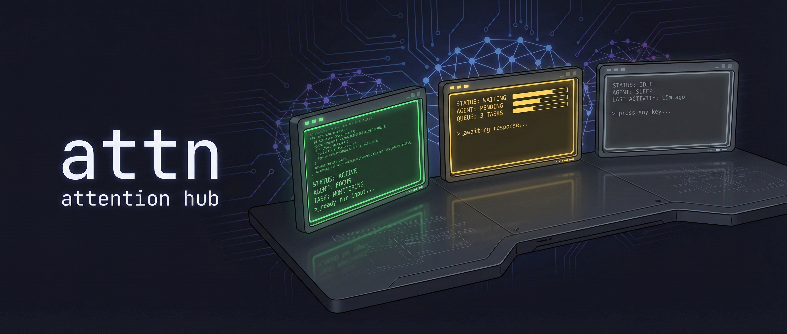

<p align="center">  </p>

# attn

**attention hub**, because your head shouldn't feel like concrete by 3pm.

I built attn after noticing a pattern: I'd start the day sharp, spin up 4-5 AI
agents across different repos, and by mid-afternoon my brain was soup. Not from
the coding, from the _managing_. Which terminal has the agent that's stuck? Did
that one finish? Wait, who asked me a question 20 minutes ago? Alt-tab, alt-tab,
alt-tab, scroll, squint, repeat.

attn stands for Attention. It's an interface that is friendly to both human and
agent brains, built as a harness augmenter. What it does today:

- **Durability.** Restart the attn app, its daemon, even your computer. Open
  attn again and your agents and terminals are still there, waiting for you.
- **Bring your own harness.** attn runs Claude Code, Codex, Pi, and other
  CLI agents. You get their native experience, but better. A big lab ships
  a fancy new feature? You get it immediately, as they designed it. Tired of
  attn? Just use the harness in the terminal.
- **The queue mode.** A (currently non-default) mode for running many agents at
  once with lower cognitive overload. Agents are either "waiting for you" or
  "busy"; after every prompt attn moves you to the next one that needs you, so
  you don't waste cycles picking. Simple, very powerful. Trust me, you want to
  try it.
- **The Garden.** attn's own task tracking. Work items are seeds you plant,
  agents tend them, and they get harvested. Like beads, but inside attn.
- **Visible orchestration.** Agents delegate to other full-blown agents (not
  subagents) that you can inspect and steer, from any harness to any harness.
  Plan with Fable in Claude Code, implement with GLM 5.3 in Pi, review in Codex
  with Sol. Agents can even message each other and arrange a party.
- **Crew members.** Custom permanent agents, each with its own charter. There's
  also the Chief that keeps track of your agents and helps you delegate, the
  executive assistant for your neurospicy brain.
- **Automations.** Start a steerable agent on a schedule or on an event (a
  review request on a PR, say) and get back a ready review guide + assessment.
- **Annotate anything, send it to the agent.** Opt/alt-select text in a live
  terminal, or in a markdown file attn renders natively (Cmd+click a `.md` path,
  or have the agent run `attn open plan.md`), leave your comments, and send the
  whole batch to the agent as one message.

There are more features, but those are the ones I use every day and am proud about.

For now the attn app is mac only. The daemon also runs on Linux. Full Linux
support is in our plans. Soon!

## The app

**Color-coded status.** Every session in one window; the one that needs you
glows. Green = working. Yellow = "hey, I need you." Gray = done.

**Profiles and desktops.** A profile groups your agents, crew and automations,
say one for work and one for personal projects. Inside it, desktops hold your
panes and tiles; Cmd+1–9 switches between them and Cmd+Option+1–9 sends the
focused pane over. Every window on the same profile shows the same desktop and
the same focused pane. Closing the focused tile returns to the most recently
focused tile still on that desktop. Closing a background tile keeps focus where
it is. Each desktop remembers this order across restarts; if no earlier focused
tile remains, focus passes to the tile on the left, then another remaining tile.
Close a desktop from its sidebar × or the palette; Cmd+W closes an empty one.
A desktop with agents, shells or tiles asks first. Closing keeps sessions in the
ledger for resuming, and selects the desktop above (or below if it was first).
The only desktop and desktops holding the chief or awake crew members stay open.
A closed launch desktop returns when its crew member wakes or its automation runs.

Use "Move with delegates to…" in the command palette to move an agent with its
delegates on the same desktop, including their delegates. Hold Option when
dropping an agent on another desktop in the sidebar for the same move. Each delegate lands beside its dispatcher;
delegates elsewhere and split shells stay where they are.

New numbered desktops land immediately after the desktop with the nearest lower
number in your current order. "Sort desktops" in the command palette sorts
numbered desktops first, then names in English alphabetic order (case-insensitive,
with Review 2 before Review 10). Unnamed desktops come last in their current order.
Undo in the toast restores your previous order; you can still drag desktops after
sorting.

**Presence.** Apps are the only source of user presence. If no app reports for
90 seconds, attn treats you as away. Away time counts from the last report
showing you present, or from daemon startup if there has been none. Crew
away notices and activity generation use that same presence reading.

**Panes, splits, and first-class shells.** A desktop can hold several sessions
side by side. Split a pane, open a plain shell as its own session from the same
dialog you use for agents, and move focus between panes with the keyboard.

**A terminal that does more.** Cmd+F finds across the full scrollback. Cmd-click
a path or URL to open it. When your shell marks commands (fish does by default),
click a command's output to grab the whole block: copy the command with its
output in one go, or filter a long block down to just the lines you want.

**PR dashboard.** Your PRs, your review requests, CI failures, merge conflicts,
one place. Works across GitHub.com and GitHub Enterprise. Open a PR directly
into a worktree.

**Git worktrees & branches.** Parallel agents need parallel branches. Spin them
up from the app. Asking attn to create a worktree enrolls its Git repository,
even if creation fails. attn remembers the repository and
monitors all its worktrees, including ones created outside attn. Monitoring
continues after the last worktree is removed and across daemon restarts.
Browsing a repository does not enroll it. The sweep keeps dirty, unmerged,
unpushed, pinned worktrees and those used by live sessions or open seeds.

## Supported agents

| Agent | State detection | Resume |
|---|---|---|
| [Claude Code](https://claude.ai/code) | Hooks + classifier + terminal title | Yes |
| [Codex](https://developers.openai.com/codex) | Hooks + classifier + terminal title | Yes |
| [Pi](https://github.com/badlogic/pi-mono) | attn plugin | Yes |

## Install

### Homebrew cask (desktop app)

```bash
brew tap victorarias/attn https://github.com/victorarias/attn
brew install --cask victorarias/attn/attn
```

This installs `attn.app` with its bundled daemon/runtime binary.

### Direct DMG

Grab the [latest release](https://github.com/victorarias/attn/releases/latest),
open the DMG, drag to Applications.

### Updating

```bash
brew update && brew upgrade --cask victorarias/attn/attn
```

The app nudges you when a new release exists.

The daemon upgrades its database when it starts, in one transaction after a
snapshot in `~/.attn/backups/`. If the upgrade fails, the daemon exits, leaves
the database and its schema version as they were, and writes
`~/.attn/migration-failure.json` naming the error, the database, the snapshot
and the log; the next successful start removes it. Other `attn` commands never
upgrade the database and refuse to open one the daemon has not upgraded yet.

## Prerequisites

- macOS (Apple Silicon)
- At least one agent CLI installed
- [GitHub CLI](https://cli.github.com/) (`gh`) v2.81.0+ for PR features

## Quick start

1. Launch **attn** from Applications.
2. **Cmd+N** starts an agent beside the focused pane: pick an
agent (or a plain shell), pick a directory, go.
3. Watch the sidebar. Colors tell you who needs you.
4. Too many concurrent agents? Enable queue mode!

Priority sessions put their owed turns ahead of other turns. Mark or unmark one
from its ••• menu or with Cmd+Shift+I (Ctrl+Alt+I on Linux). The flag stays until
you clear it, including across restarts, /clear, seed handovers and crew naps.
Snoozed sessions stay snoozed, and marking an agent never interrupts the one
on screen. Settling a turn advances to an owed priority turn first.

Agents can use `attn session priority on|off [--session <id>]`, defaulting to
their own session. `attn delegate --priority` starts a marked delegate.

`attn session snooze <id>... --until 1h` puts off turns for one or several
sessions, including working agents before they finish. `--until` also accepts
an RFC3339 instant or tomorrow, saturday and monday at local 09:00 (for a
custom time, quote `"tomorrow 09:00"`). `attn session unsnooze <id>...` ends
the snooze early. Agents may act on themselves and their delegates; the chief
may act on any session of its profile. `attn session list` and `show` display
the snooze deadline. CLI snooze currently supports local sessions.

5. Press **Cmd+/** any time for the full shortcuts list.

## Session states

| Color | What it means |
|---|---|
| 🟢 Green | Agent is working. Leave it alone |
| 🟡 Yellow | Agent needs you: ended on a question, or finished a long run (5+ min) and is waiting for your review |
| 🟡 Flashing | Agent is blocked on a prompt: a tool approval or a question. Go answer it |
| 🔵 Blue (slow pulse) | Parked on a `/loop` or schedule. It'll resume itself |
| 🟣 Purple | State couldn't be read reliably. Worth a glance |
| ⚪ Gray | Done, or a plain shell. Move on |

## Shortcuts

| Shortcut | What it does |
|---|---|
| Cmd+N | New session beside the focused pane |
| Cmd+Shift+N | New session, split sideways |
| Cmd+D / Cmd+Shift+D | Split pane down / sideways |
| Cmd+Option+←↑→↓ | Move between panes (steps to the next desktop at an edge) |
| Cmd+1–9 | Switch to desktop 1–9 |
| Cmd+Option+1–9 | Send the focused pane to desktop 1–9 |
| Cmd+G | Desktop overview |
| Cmd+Shift+U | Switch profile |
| Cmd+Up / Down | Jump between sessions |
| Cmd+F | Find in terminal |
| Cmd+K | Agent palette (crew, agents, tiles, runs) |
| Cmd+Shift+K | Command palette (or type `>` in the agent palette) |
| Cmd+Shift+I | Mark or unmark the focused agent as priority |
| Cmd+Shift+A | All agents: the list in the queue sidebar, the agent palette elsewhere |
| Cmd+Shift+P | Attention drawer (who needs me?) |
| Cmd+Shift+R | Asks drawer: answer what your agents asked |
| Cmd+\` | Utility terminal |
| Cmd+R | Refresh PRs |
| Cmd+/ | All keyboard shortcuts |

Every binding is customizable. Press **Cmd+/** in the app for the full,
always-current list, and "Edit shortcuts" there to remap any of them.

Picking an agent, tile or desktop gives it the keyboard immediately. You can
start typing while the daemon confirms the selection; an agent still getting
its terminal retains that input until it is ready.

In desktop flow, keyboard jumps, palette selections, and clicks on panes smoothly
center the selection in the expanded sidebar or collapsed desktop rail. Clicking
inside either list keeps its scroll position. Reduced motion makes these jumps
instant; going Home clears the list selection.

The command palette keeps available current-agent actions pinned near the top.
Other commands rise as you select them in the palette, with history shared
within each profile. Each selection's weight halves every two weeks, so the
order adapts when your habits change. Stronger text matches come first when
you search. History stays fixed for an opening; reopening picks up new uses.

### Selecting text in agent terminals

Agents like Claude Code enable terminal mouse tracking, which means a normal
click-drag is forwarded to the agent instead of creating a selection. **Hold
Option while dragging** to bypass mouse tracking and make a selection you can
copy, the same convention iTerm2, Terminal.app, and kitty use.

If the agent explicitly copies text for you (e.g. "copy this to my clipboard"),
attn honors the terminal's OSC 52 clipboard sequence and writes to your Mac
clipboard directly. No xclip / X server needed on the remote.

## Working with many agents

Your agents can work as a team:

- **Delegation.** Delegation starts a steerable agent on a seed. Supply a brief
  for new work or a seed for an existing assignment, plus an explicit working
  folder and Git choice:

      attn delegate --brief-file task.md --role builder \
        --cwd /repo --new-worktree --branch feature-x --from origin/main

  Relative `--cwd` paths, including `.`, resolve from the CLI's current
  directory. A new worktree preserves the selected checkout subdirectory.

  Add `--desktop 7` to place the delegate on ⌘7. If that numbered desktop is
  missing, attn recreates it on its shortcut slot and keeps the current desktop
  in view. A desktop name or id also works within the same profile.

  To hand the same seed to an executor, record the next step without repeating
  its plan:

      attn delegate --seed s-example --handover --role orchestrator \
        --cwd /repo --reuse-checkout --branch feature-x \
        -m "The user approved the plan. Execute it."

  The previous agent remains running. The CLI prints a stable request ID before
  mutation; use `attn delegate status <request-id>` when the outcome is uncertain.
- **The Garden.** `attn seed plant`, `tend`, `note`, `harvest`. Seeds are what
  agents hand off to each other and what survives a restart, a new session, or a
  new chief.
- **Agent messaging.** Agents in different sessions, harnesses, and hosts can
  message each other.
- **In-app browser.** `attn browser open <url>` docks a real browser an agent
  can drive; log in once and it persists.

### Watching pull requests

Run `attn pr watch <url>` from an agent session to receive readiness, failed checks,
review findings, human comments and replies, reopened review threads, and monitoring
outages in its inbox. Watches survive restarts; unchanged observations do not
repeatedly ping the agent. Feedback present at the first successful check is the
baseline, and changing modes keeps that feedback history. Unwatching and rearming
starts a new baseline.

The default `green` mode is ready when the PR is open, non-draft, and GitHub reports
`CLEAN` or `HAS_HOOKS`. Use `--mode codex` to additionally require the exact Codex
app actor's 👍 and no 👀 after a 30-second settling window. Reactions are a best-effort
signal because GitHub does not attach them to a commit. Use `--mode formal-review`
for GitHub's aggregate approval, or add `--reviewer <login>` to require that actor's
current formal opinion. Comments, threads, changes requested, and failed checks are
feedback worth surfacing, not extra readiness gates. A watch never changes GitHub
state or grants merge authority.

Inspect with `attn pr status`; stop with `attn pr unwatch <url>`. Stopping clears
that session's unread watch notifications. Closing or merging the PR ends the watch.
For development instances, enable
[GitHub polling](docs/instances.md#github-polling).

Prefer a blocking terminal workflow? Use `attn pr wait-ready <pr> --repo <owner/repo>
--mode <green|codex|formal-review>`. Its `--help` explains reviewers, baselining,
resume, and exit codes.

### Quiet notifications (experimental)

attn wakes agents all day: a delegate's message, a seed update, a pull request
update. Turn on **Settings → Experimental → Quiet notifications in the queue** so
those wake-ups stop sending you to agents that do not need you. In queue flow:

- An agent a notification woke stays out of your queue when it stops, unless it
  needs an approval.
- An agent waiting for you leaves the queue when a notification sets it working
  again. If it is on screen you stay there; settle moves you on as usual.
- An agent that needs you runs `attn turn open`, which puts it in your queue
  when it stops. Notifications do not take it out: you settle it, or the agent
  runs `attn turn settle`.

If you type into an agent while it works on a notification, the run is yours,
and its stop puts it in your queue as usual.

### Asks (experimental)

Turn on **Settings → Experimental → Asks** to let agents ask you what they
cannot settle alone without stopping to wait for you in their terminal. An agent
pipes markdown to `attn ask`: prose, mermaid diagrams and screenshots, with
question blocks for one choice (`:::question`), any number (`:::question-multi`)
or a written answer (`:::question-text`). It keeps working on what does not
depend on the answer.

Press **Cmd+Shift+R** to answer every agent from one drawer, waiting agents first.
Pick choices, write answers, add a note and send with **Cmd+Enter**; the drawer
brings the next ask. Your answer settles the agent's turn, and attn types it into
the agent's conversation as your message right away, even while it works (an
approval it waits on goes first), so its auto mode accepts the approvals in it.
**Open agent** jumps to its terminal.

The queue, the sidebar and the home screen mark the agents that asked, and the
sidebar's Asks button counts open asks. With the sidebar collapsed, the queue bar
counts open asks and lists them on hover; in desktop flow the rail keeps the count
and marks the desktops of the agents that asked. The asking agent's tile header
shows its ask: hover it to read the question, click it to answer.

An ask is about the seed its agent works on: the one a delegation assigned them,
or another seed they tend. The drawer names the seed, and **Open in Garden** shows
it beside the ask. Your answer goes to whoever tends the seed then, and the seed
keeps it as a note, so the ask outlives the agent that asked. Harvest or wither
the seed and its asks close. Agents keep the setting they launched with, reloads
included.

### The Chief

Running five agents shouldn't turn you into a full-time dispatcher. The Chief is
the manager of your agent team: you work with it to shape focused missions, you
decide what gets delegated, and the Chief keeps the threads connected as the
work develops. It follows what each agent reports, surfaces blockers and
collisions, and tees up the decisions that need your judgment.

The Chief is an awareness layer you work alongside. Ask it for the state of the
whole mission, or drop into an agent and work beside it. When something
finishes, fails, or needs input, the Chief brings back what changed and the
natural next step.

Handoffs cross harnesses. Ask Fable in Claude Code to brainstorm a plan, bring
it back through the Chief, then have the Chief prepare a follow-on delegation to
GPT 5.6 Sol in Codex. You choose each handoff; the Chief preserves the context
and artifacts between them.

#### Give the Chief an office

A dedicated folder where you describe how you work and keep the plans,
responsibilities, and knowledge that span all your repos:

```text
chief-of-staff/
├── .gitignore            # ignore attn's machine state if this is a private repo
├── AGENTS.md             # the chief's constitution
├── CLAUDE.md             # -> AGENTS.md (symlink, or a file containing `@AGENTS.md`)
├── projects/index.md     # active initiatives, outcomes, and why they matter
├── areas/index.md        # ongoing responsibilities and standards to maintain
├── resources/index.md    # durable reference material
├── archive/index.md      # finished or inactive material
└── notebook/             # optional: keep attn's Notebook in the same home
```

`AGENTS.md` is the Chief's constitution: what good support looks like, how you
make decisions, when to explore versus execute, how it should propose and
structure delegations, and where your important code and systems live. Current
project state lives in the folders. A starter:

```md
# My chief of staff

This is my coordination and knowledge workspace. Help me manage my agents and
act as my thinking partner.

## Working relationship

- Reduce my cognitive load. Surface what matters and make the next move clear.
- Gather evidence before recommending action.
- When a choice is ambiguous, frame the decision and its tradeoffs.

## Delegation

- I decide every delegation; a goal is not approval to run it end to end.
- Propose a delegation, harness, and model when a separate specialist would
  help.
- Give each agent a clear outcome, context, constraints, and handoff.
- Track what the agents report and bring me blockers, collisions, and
  consequential decisions.

## Organization

- Read projects/index.md before discussing priorities or incoming work.
- projects/ holds time-bound efforts with a clear outcome.
- areas/ holds ongoing responsibilities and standards.
- resources/ holds reference material useful across projects.
- archive/ holds inactive material. Move completed projects here.

## Boundaries

- Planning, research, decisions, and coordination live here.
- Implementation, tests, commits, and pull requests live in the owning repo.
```

To keep everything in one syncable folder, open **Settings → Notebook Folder**
and point it at `chief-of-staff/notebook`. Add `notebook/.attn/` to
`.gitignore`; it is machine state. Changing the Notebook Folder does not move
existing notes.

Then: **Cmd+T**, pick a harness, select the `chief-of-staff` folder, turn
**Chief of Staff** on (or pick **Make chief of staff** from an existing
session's menu), and give it a mission:

> We need to ship the new import flow this week. Help me understand what's
  already in flight, suggest how to break it down, and prepare delegation
  options. As the agents work, keep the threads connected and bring me the
  blockers, collisions, and decisions that need my judgment.

## Build from source

Requires Go 1.27+, Rust (stable), Node.js 26+, pnpm, and [Tauri
prerequisites](https://v2.tauri.app/start/prerequisites/).

Source builds intentionally disable GitHub release update banners by default.

```bash
git clone https://github.com/victorarias/attn.git && cd attn
```

| Command | What it does |
|---|---|
| `make build` | Build the Go daemon binary |
| `make` | Install attn.app and launch it, the one-command inner loop |
| `make install` | Install the app bundle without launching (scripts / CI) |
| `make dev` | Install and launch the isolated `attn-dev.app` sibling; rebuilds never touch your live install |
| `make dist` | Create a DMG |
| `make test` | Go tests |

Developing attn while running attn? `make dev` gives you a fully isolated dev
sibling (own bundle, data dir, and port) so rebuilds never touch your live copy.
The full dev-loop, instance, and harness targets live in
**[docs/instances.md](docs/instances.md)** and [AGENTS.md](AGENTS.md).

## Docs

| | |
|---|---|
| [Instances](docs/instances.md) | Run multiple isolated attn worlds side by side |
| [Shared Codex](docs/using-shared-codex.md) | Experimental: Codex terminals sharing one app-server, with hidden sessions |
| [Outposts](docs/using-outposts.md) | Experimental: connect attn on other computers, where agents will run |
| [Release](docs/making-a-release.md) | Maintainer runbook |

## Status

Alpha. I use it every day. It's rough around the edges, but it works really well
once you get going. The app is mac only for now; the daemon runs on Linux and
full Linux support is planned.

## A note about this project

I built attn because I needed it. Managing multiple agents was the bottleneck,
not the coding itself.

I work full time, and I have 2 dogs and 4 cats at home. Free time is not
abundant. attn is open source, but if you need changes I can't get to, **fork
it**. That's encouraged, not rude.

**Issues are welcome**, but please be detailed:

- Describe what happened and what you expected.
- Include the tail of `~/.attn/daemon.log` from right after you reproduced the
  issue.
- For visual bugs, attach a screenshot.

Vague "it doesn't work" reports aren't actionable and will sit there forever.

I'm a friendly person and happy to help when I can. But don't be entitled about
it; that's the one thing I can't deal with. Entitled behavior gets ignored, and
if I'm having a bad day, maybe banned.

## Built with

[Tauri](https://tauri.app) / [React](https://react.dev) / [Go](https://go.dev) /
[SQLite](https://sqlite.org)

## License

[GPL-3.0](LICENSE)
