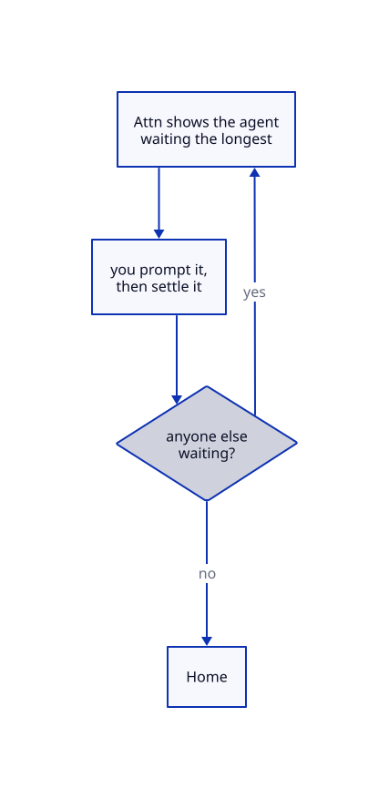
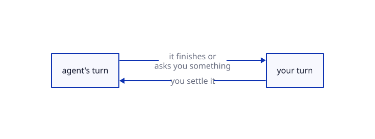

# Queue flow

In queue flow, Attn removes the need to pick the next agent to prompt. Attn
takes you to the next agent that needs you, and repeats that until all of them
are settled and doing their work.

The loop has three steps:

1. Attn shows you the agent that has been waiting the longest.
2. You prompt the agent, then settle it with Cmd+Shift+E (Ctrl+Alt+E on Linux).
3. Attn takes you to the next agent waiting for you, and the loop starts again at step 1.

Driving agents costs humans effort. We make impactful decisions much more often
than before, so cutting the number of decisions saves mental energy. Queue flow
cuts decisions: you stop asking yourself which agent to go to next, and
Attn picks the agent for you.

We've seen this way of working increase throughput a lot.

## Turning it on

Open the command palette with Cmd+Shift+K (Ctrl+Alt+K on Linux) and run "Turn on
the agent queue", or click the flow toggle ("Switch to queue flow") at the top
of the sidebar. Either one also turns the queue off again. The sidebar changes shape: below
Home and your crew, the agents waiting for you are listed oldest first.

## Turns

In queue flow, every agent is either working or waiting for you. While an agent
works, it is the agent's turn. When the agent finishes or asks you something, it
is your turn, and the agent is owed a turn. When you settle the agent, the turn
goes back to the agent.

The "N waiting" line at the top of the queue counts how many agents are waiting
for you. Click it, or press Cmd+J (Ctrl+Shift+J on Linux), to go to the agent at
the top of the queue.

## Settle

You can settle an agent:

- Directly, with Cmd+Shift+E (Ctrl+Alt+E on Linux), the ✓ on its row in the
  sidebar, or "Settle this agent" in the command palette.
- Automatically, with auto-settle. Auto-settle is off by default. Turn it on in
  **Settings → Attention queue** ("Settle a turn once you have steered the agent"),
  or run "Turn on auto-settle" from the command palette. You set how long the
  agent must keep working before the countdown starts, and how long the
  countdown runs. The agent's tile header shows the countdown, and the agent's
  sidebar row shows it when the agent isn't on screen. Cmd+. (Ctrl+Shift+. on
  Linux) stops the countdown.
- With a snooze.

Settling takes you to the next agent waiting for you, or Home when nobody is.
Cmd+Shift+E on an agent that is working takes you to the front of the queue.

A snooze settles an agent for a period of time. Use it when you don't want to
close the agent but can't make a decision yet. Three controls open the snooze choices: Cmd+Shift+S (Ctrl+Alt+S on Linux), the snooze button on the agent's row, and "Snooze this agent…" in the command palette. The choices are 30 minutes, an hour, 2, 4 or 8 hours, or until
tomorrow, Saturday or Monday at 9:00. Snoozed agents wait at the end of the full
agent list ("N more agents" in the sidebar, or Cmd+Shift+A, Ctrl+Alt+A on
Linux), each with the time its snooze ends. To unsnooze an agent, click the unsnooze
button on the agent's row (the app labels it Wake), or open the agent and run
"Wake this agent now" from the command palette. A snooze ends early if the
agent's process exits or Attn loses track of the agent's state.

## Priority

Sometimes an agent matters more than the others, and you want to settle it
before anything else in your queue.

Move an agent to the front of the queue with Cmd+Shift+I (Ctrl+Alt+I on
Linux), "Mark priority" in the ••• menu on the agent's row, or "Mark as
priority" in the command palette. A ⚑ marks the agent in the sidebar. Priority turns come first, in the
order they opened. The flag stays until you clear it, across restarts, /clear,
handovers and crew harness switches. A snoozed agent stays snoozed when you
mark it.

## Details

Why is an idle agent in my queue?

An agent is owed a turn as soon as its state becomes waiting, needs approval, idle or unknown, apart from the stops that [quiet notifications](#quiet-notifications) keep out. An idle agent has nothing left to do, so the next move is yours. An unknown agent may need you because Attn can't tell what it's doing. Becoming working, launching, scheduled or recoverable never opens a turn. An agent that Attn brings back after a reboot becomes idle at its prompt, so it is owed a turn even if you had settled it. Only you can tell whether it should continue. A Claude agent that compacts its conversation by itself while it sits at its prompt has said nothing new, so it opens no turn when the compaction ends.

Why is a working agent still in my queue?

Prompting an agent doesn't settle its turn, so the turn stays owed while the agent works on what you asked. The turn closes when you settle or snooze the agent, or when auto-settle settles the turn for you. Until then the turn stays at the position it took when it opened, even if the agent stops and starts again.

Why didn't settling take me to the oldest agent?

Settling takes you to the agent after the one you settled, in queue order, and wraps to the top at the end. If you jumped into the middle of the queue, settling continues from there. Cmd+J (Ctrl+Shift+J on Linux) takes you back to the top. A priority turn at the top always comes first. When auto-settle or a snooze closes the turn on your screen, you move the same way. Settling another agent from its row keeps you where you are.

What stays out of the queue?

Shells and the Chief are never owed a turn, and the Chief keeps its own slot in the Crew section of the sidebar. Crew members also stay in the Crew section until you turn on "Put the crew in the queue", a switch in Settings → Attention queue (search "crew") that the command palette also offers. Turning it off, or running "Take the crew out of the queue", undoes that. Automation runs get their own group in the sidebar, and Cmd+Shift+J (Ctrl+Alt+J on Linux) takes you to the next run that is owed a turn. Delegates are full agents, so they queue like any other.

Where are my agents that aren't waiting?

The sidebar lists as many waiting agents as fit, at least three, and a row below them counts the rest. Cmd+Shift+A (Ctrl+Alt+A on Linux) opens the full list, with a filter you can type into. The list shows the remaining waiting agents first, then the settled ones under Working, then the snoozed ones, with the snooze ending soonest on top. Cmd+Up and Cmd+Down (Ctrl+Shift+PageUp and Ctrl+Shift+PageDown on Linux) move you through that same order and wrap around at the ends. Cmd+Option+Up and Cmd+Option+Down (Ctrl+Shift+Up and Ctrl+Shift+Down on Linux) move you through the same order once you run out of tiles on the desktop.

When exactly does auto-settle settle a turn?

Auto-settle starts when an agent that is owed a turn goes back to work on a prompt you typed or annotations you sent. Work that starts from a message in the agent's inbox doesn't count. By default auto-settle waits through 30 seconds of work, then counts down for 15 seconds and settles the turn. You can set the wait from 5 to 3600 seconds and the countdown from 3 to 600, in **Settings → Attention queue**. Typing in the agent's terminal or moving the mouse over the terminal pauses auto-settle until you've been still for 5 seconds. Then the wait or countdown starts over. Auto-settle cancels as soon as the agent is no longer working.

How do I keep a turn that auto-settle is about to settle?

Press Cmd+. (Ctrl+Shift+. on Linux), or click "Settling…" in the tile header. The key stops every countdown on screen, and auto-settle leaves those agents alone until they next stop working. With no countdown showing, the key marks the agent you're looking at "Turn kept" instead, so the agent's current or next stretch of work won't settle the turn. Pressing the key again undoes that.

What happens on Home when nobody is waiting?

When settling leaves nobody waiting, Attn takes you to Home. Home shows "All settled" and a ticked box labeled "Take me to the next agent that needs you". While the box is ticked, Attn takes you to the next agent as soon as a turn opens, unless you go somewhere else first. If you go Home yourself with Cmd+Shift+H (Ctrl+Alt+H on Linux), the box stays unticked until you tick it.

What happens when a snoozed agent finishes or asks for approval?

The agent stays snoozed, and it has no turn until the snooze ends. If the agent is then waiting, needs approval, is idle or is unknown, it gets a turn dated to when the snooze ended, so the turn comes after turns that opened earlier. If the agent is still working, it goes back under Working and is owed a turn the next time it waits for you.

Can the Chief or my agents snooze or prioritize agents for me?

Yes. Ask the Chief or an agent, or run `attn session snooze <id> --until <when>` yourself. `<when>` is a duration such as `2h`, one of `tomorrow`, `saturday` or `monday` (9:00 unless you add a time, as in `"tomorrow 14:00"`), or an exact RFC 3339 time. An agent can snooze itself and the agents below it in its delegation chain. The Chief can snooze any agent in the Chief's profile. From a terminal outside Attn, you can snooze any agent. `attn session unsnooze <id>` follows the same rules. `attn session priority on|off --session <id>` sets or clears the flag on any agent. Without `--session`, the command acts on the agent running it. Snoozing settles the agent's turn until the snooze ends. Unsnoozing and changing priority settle nothing. An agent can put itself in your queue with `attn turn open` and take itself out with `attn turn settle`, but only for a turn it opened that way. A turn that opened when the agent stopped is yours to settle.

Do turns and snoozes survive a restart?

Yes. Attn keeps owed turns and snoozes in its database, so restarting the app, the daemon or your machine doesn't settle a turn or lose a snooze. A snooze that ran out while the daemon was stopped ends as soon as the daemon starts again. A daemon restart does drop a running auto-settle countdown, and that turn stays owed until you settle it.

Does the queue cover all my profiles?

Each profile has its own queue, and it holds only that profile's agents. Turning the queue on or off applies to every profile at once, and so do auto-settle and the crew switch.

## Quiet notifications

Attn wakes agents all day: a delegate's message, a seed update, a pull request
update, the answer to an ask. Those wake-ups don't send you to agents that do
not need you. In queue flow:

- An agent a notification woke stays out of your queue when it stops, unless it
  needs an approval or Attn can't tell what it's doing.
- An agent waiting for you leaves the queue when a notification sets it working
  again. If the agent is on screen, you stay there, and settle moves you on as usual.
- An agent that needs you runs `attn turn open`. That command puts the agent in
  your queue when the agent stops. Notifications do not take the agent out. You
  settle the agent, or the agent runs `attn turn settle`.

A message you send through [Quick Capture](quick-capture.md) or `attn send` is not a notification.
Its run is yours, and the agent goes into your queue when it stops, so you see
the reply. The same happens if you type into an agent or send it such a message
while it works on a notification.

Quiet notifications are on by default. To have every notification run open a
turn when it stops, turn off **Settings → Attention queue → Quiet notifications
in the queue**.
