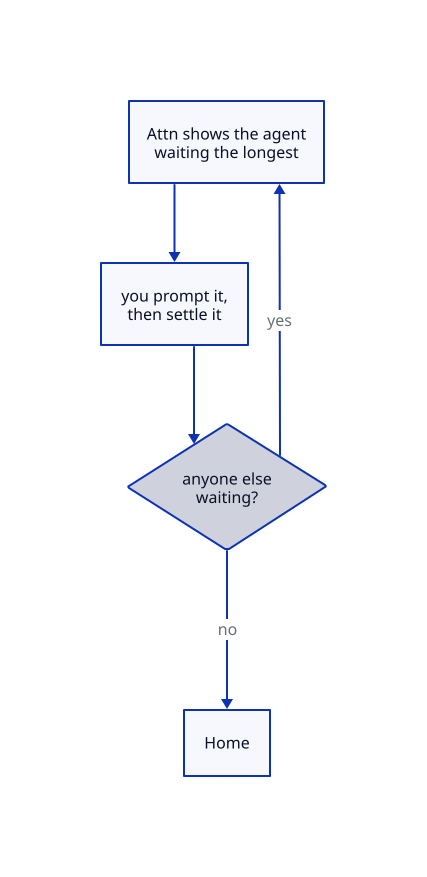
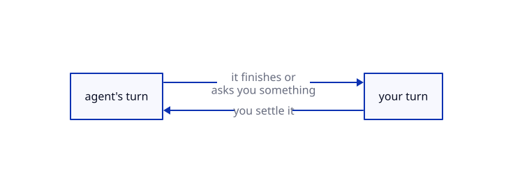

# Queue flow

In queue flow, Attn removes the need to pick the next agent to prompt. Attn
takes you to the next agent that needs you, and repeats that until all of them
are settled and doing their work.

The flow is simple:

1. You are presented the agent that has been waiting the longest.
2. You prompt the agent, then settle it with Cmd+Shift+E (Ctrl+Alt+E on Linux).
3. Attn takes you to the next agent waiting for you, back at step 1.

Driving agents has a non-trivial cost for humans. We are forced to make
impactful decisions at a much higher frequency than before, so cutting the
number of decisions saves a lot of mental energy. That's where the queue flow
shines: you stop asking yourself which agent to go to next, and let Attn pick it
for you.

We've seen this way of working increase throughput a lot.

## Turning it on

Open the command palette with Cmd+Shift+K (Ctrl+Alt+K on Linux) and run "Turn on
the agent queue", or click the flow toggle ("Switch to queue flow") at the top
of the sidebar. Either one turns it off again. The sidebar changes shape: below
Home and your crew, the agents waiting for you are listed oldest first.

## Turns

In queue flow, it's always someone's turn: the agent's, while it does its work,
or yours, while it waits for you. When it's your turn, the agent is owed a turn.
When you hand the turn back, the agent is settled.

The "N waiting" line at the top of the queue counts how many agents are waiting
for you. Click it, or press Cmd+J (Ctrl+Shift+J on Linux), to go to the agent at
the top of the queue.

## Settle

You can settle an agent:

- Directly, with Cmd+Shift+E (Ctrl+Alt+E on Linux), the ✓ on its row in the
  sidebar, or "Settle this agent" in the command palette.
- Automatically, with auto-settle. It's off by default; turn it on in Settings →
  Attention queue ("Settle a turn once you have steered the agent"), or run
  "Turn on auto-settle" from the command palette. You set how long the agent
  must keep working before the countdown starts, and how long the countdown
  runs. The agent's tile header shows the countdown (its sidebar row does when
  the agent isn't on screen), and Cmd+. (Ctrl+Shift+. on Linux) stops it.
- With a snooze.

Settling takes you to the next agent waiting for you, or Home when nobody is.
Cmd+Shift+E on an agent that's on its own turn takes you to the front of the
queue.

A snooze settles an agent for a period of time. Use it when you don't want to
close the agent but can't make a decision yet. Cmd+Shift+S (Ctrl+Alt+S on
Linux), the snooze button on its row, or "Snooze this agent…" in the command
palette offers the choices: 30 minutes, an hour, 2, 4 or 8 hours, or until
tomorrow, Saturday or Monday at 9:00. Snoozed agents wait at the end of the full
agent list ("N more agents" in the sidebar, or Cmd+Shift+A, Ctrl+Alt+A on
Linux), each with the time its snooze ends. To unsnooze one, click the unsnooze
button on its row (the app labels it Wake), or open it and run "Wake this agent now" from the command
palette. A snooze ends early if the agent's process exits or Attn loses track of
its state.

## Priority

Sometimes an agent matters more than the others, and you want to settle it
before anything else in your queue.

Make an agent jump to the front of the queue with Cmd+Shift+I (Ctrl+Alt+I on
Linux), "Mark priority" in the ••• menu on its row, or "Mark as priority" in the
command palette. A ⚑ marks it in the sidebar. Priority turns come first, in the
order they opened. The flag stays until you clear it, across restarts, /clear,
handovers and crew harness switches. A snoozed agent stays snoozed when you mark it.

## Details

Why is an idle agent in my queue?

An agent owes you a turn as soon as its state becomes waiting, needs approval, idle or unknown. An idle agent has nothing left to do, so the next move is yours. An unknown one may need you because Attn can't tell what it's doing. Becoming working, launching, scheduled or recoverable never opens a turn.

Why is a working agent still in my queue?

Prompting an agent doesn't settle its turn, so the turn stays owed while the agent works on what you asked. It closes when you settle or snooze the agent, or when auto-settle settles it for you. Until then it keeps the place it got when it opened, even if the agent stops and starts again.

Why didn't settling take me to the oldest agent?

Settling takes you to the agent after the one you settled, in queue order, and wraps to the top at the end. If you jumped into the middle of the queue, you carry on from there, and Cmd+J (Ctrl+Shift+J on Linux) takes you back to the top. A priority turn at the top always comes first. The same happens when the turn on screen closes through auto-settle or a snooze, while settling another agent from its row keeps you where you are.

What stays out of the queue?

Shells and the Chief never owe you a turn, and the Chief keeps its own slot in the Crew section of the sidebar. Crew members also stay in the Crew section until you run "Put the crew in the queue" from the command palette; "Take the crew out of the queue" undoes it. Automation runs get their own group in the sidebar, and Cmd+Shift+J (Ctrl+Alt+J on Linux) takes you to the next run that owes you a turn. Delegates are full agents, so they queue like any other.

Where are my agents that aren't waiting?

The sidebar lists as many waiting agents as fit, at least three, and a row below them counts the rest. Cmd+Shift+A (Ctrl+Alt+A on Linux) opens the full list, with a filter you can type into. It shows the remaining waiting agents first, then the settled ones under Working, then the snoozed ones, with the snooze ending soonest on top. Cmd+Up and Cmd+Down (Ctrl+Shift+PageUp and Ctrl+Shift+PageDown on Linux) step through that same order and wrap around at the ends, and Cmd+Option+Up and Down (Ctrl+Shift+Up and Down on Linux) do the same once they run out of tiles on the desktop.

When exactly does auto-settle settle a turn?

It starts when an agent that owes you a turn goes back to work on a prompt you typed or annotations you sent (work that starts from a message in its inbox doesn't count). By default it waits through 30 seconds of work, then counts down for 15 seconds and settles the turn. You can set the wait from 5 to 3600 seconds and the countdown from 3 to 600, in Settings → Attention queue. Typing in the agent's terminal or moving the mouse over it pauses auto-settle until you've been still for 5 seconds, then the wait or countdown starts over, and it's cancelled as soon as the agent is no longer working.

How do I keep a turn that auto-settle is about to settle?

Press Cmd+. (Ctrl+Shift+. on Linux), or click "Settling…" in the tile header. The key stops every countdown on screen, and auto-settle leaves those agents alone until they next stop working. With no countdown showing, it marks the agent you're looking at "Turn kept" instead, so its current or next stretch of work won't settle the turn, and pressing it again undoes that.

What happens on Home when nobody is waiting?

When settling leaves nobody waiting, you land on Home with "All settled" and "Take me to the next agent that needs you" ticked. Attn then takes you to the next agent the moment a turn opens, unless you've gone somewhere else first. Going Home yourself with Cmd+Shift+H (Ctrl+Alt+H on Linux) leaves the box unticked until you tick it.

What happens when a snoozed agent finishes or asks for approval?

It stays snoozed, and its turn waits until the snooze ends. If the agent is waiting, needs approval, is idle or is unknown by then, it gets a turn dated to when the snooze ended, so it lines up behind turns that opened earlier. If it's still working, it goes back under Working and owes you a turn the next time it waits for you.

Can the Chief or my agents snooze or prioritize agents for me?

Yes. Ask the Chief or an agent, or run `attn session snooze <id> --until <when>` yourself. `<when>` is a duration like `2h`, one of `tomorrow`, `saturday` or `monday` (9:00 unless you add a time, as in `"tomorrow 14:00"`), or an exact RFC 3339 time. An agent can snooze itself and the agents below it in its delegation chain, the Chief can snooze any agent in its profile, and from a terminal outside Attn you can snooze any agent. `attn session unsnooze <id>` follows the same rules. `attn session priority on|off --session <id>` sets or clears the flag on any agent; without `--session` it acts on the agent running it. None of these settle a turn for you. An agent can put itself in your queue with `attn turn open` and take itself out with `attn turn settle`, but only for a turn it opened that way; a turn that opened when it stopped is yours to settle.

Do turns and snoozes survive a restart?

Yes. Attn keeps owed turns and snoozes in its database, so restarting the app, the daemon or your machine doesn't settle a turn or lose a snooze. A snooze that ran out while the daemon was stopped ends as soon as the daemon starts again. A daemon restart does drop a running auto-settle countdown, and that turn stays owed until you settle it.

Does the queue cover all my profiles?

Each profile has its own queue, and it holds only that profile's agents. Turning the queue on or off applies to every profile at once, and so do auto-settle and "Put the crew in the queue".

## Quiet notifications (experimental)

Attn wakes agents all day: a delegate's message, a seed update, a pull request
update, the answer to an ask. Turn on **Settings → Experimental → Quiet
notifications in the queue** so those wake-ups stop sending you to agents that
do not need you. It's off by default. In queue flow:

- An agent a notification woke stays out of your queue when it stops, unless it
  needs an approval or Attn can't tell what it's doing.
- An agent waiting for you leaves the queue when a notification sets it working
  again. If it is on screen you stay there; settle moves you on as usual.
- An agent that needs you runs `attn turn open`, which puts it in your queue
  when it stops. Notifications do not take it out: you settle it, or the agent
  runs `attn turn settle`.

If you type into an agent while it works on a notification, the run is yours,
and its stop puts it in your queue as usual.
