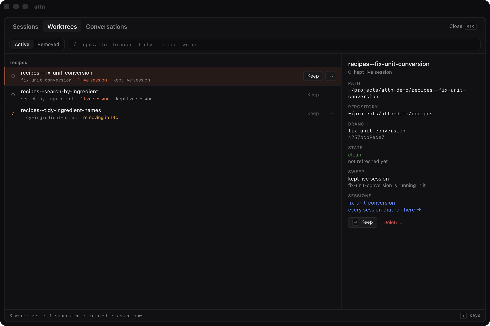
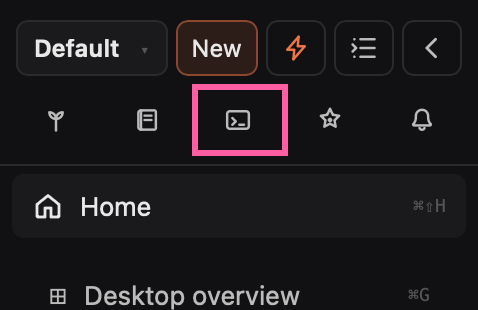

# Sessions

A session is Attn's record of one conversation with an agent. Attn keeps every
session, live and closed, so you can always find an agent again and bring it
back.

## Opening an agent

Cmd+N (Ctrl+Shift+N on Linux), or New at the top of the sidebar, opens the
picker. Pick a harness or a plain shell, then a directory. In a git repository,
Tab moves on to where the agent works: a new worktree (type to name its
branch), the main checkout, or a worktree that already exists. Enter starts it.

Attn runs Claude Code and Codex, and other harnesses through plugins. You get
each harness as its makers built it, and you can still use its bare CLI whenever you want.
Nisse is experimental and off by default. See [Using Nisse](using-nisse.md).

### The launcher

**Launcher 2.0** in **Settings → Experimental**, off by default, replaces the
picker with one dialog for the path, the repository and the worktree. Cmd+N
(Ctrl+Shift+N on Linux) opens it for a new agent, and Cmd+T (Ctrl+Shift+T on
Linux) opens it with a shell picked.

- Type a project or a path, and use ↑ and ↓ to move through the list. Enter
  starts on the selected row.
- For an agent, Tab on a repository opens its worktree choices. Type to name a
  new worktree, or pick the main checkout or a worktree that already exists.
- Tab on any other row, and on every row in a terminal launcher, puts the row's
  address in the input.
- Cmd+Enter (Ctrl+Enter on Linux) opens a terminal at the selected place instead
  of starting an agent.
- Esc goes back a step, or closes the launcher.

With an outpost added, the same dialog starts agents on any machine. [Start on an
outpost from the launcher](using-outposts.md#start-on-an-outpost-from-the-launcher)
covers addresses and what happens when a machine is unreachable.

## Worktrees

Worktrees let many agents work on the same codebase in parallel without
interfering with each other: each agent gets its own isolated checkout.

Attn creates worktrees for your agents. Attn removes a worktree automatically
after two weeks without activity, if removing it loses nothing. The FAQ "Why is
Attn keeping my worktree?" lists every condition that keeps a worktree.

You can see and manage your worktrees in the ledger's Worktrees tab, and keep
one forever from there.



## The terminal

- Cmd+F (Ctrl+Shift+F on Linux) searches the whole scrollback.
- Agents like Claude Code track the mouse, so a plain drag goes to the agent.
  Hold Option (Alt on Linux) while you drag to select text instead.
- When an agent copies text for you, Attn honors the terminal's OSC 52
  clipboard sequence and puts the text on your clipboard, even from a remote machine.
- Cmd-click (Ctrl-click on Linux) a path or URL to open it. A `.md` file opens
  in a markdown tile next to the agent.
- If your shell marks commands (fish does by default), click a command's output
  to select the whole block. Cmd+C (Ctrl+Shift+C on Linux) copies the command
  and its output. Cmd+Shift+C (Ctrl+Alt+C on Linux) copies only the command.
  Right-click a block to choose Copy output, Filter block output, or a scroll to
  the block's top or bottom.

## Durability

Restarting the app doesn't interrupt your agents. Restarting the daemon doesn't
either. After your machine reboots, Attn restarts each agent on its desktop with the
conversation resumed. Work in progress stops with the reboot, so each agent
waits at its prompt and is owed a turn. A shell stays marked recoverable until
you open it.

## The ledger

Cmd+Shift+L (Ctrl+Alt+L on Linux), or the Ledger icon at the top of the
sidebar, opens the ledger: every session, live and closed, plus the worktrees
and conversations they used, in the Sessions, Worktrees and Conversations tabs.
When you close an agent, its session waits here.



## Resume

Resume opens a closed session again in a tile, as the same session and with
its conversation. The ledger labels this action **Reopen**. The session opens on
the desktop it was last on. When that desktop is gone, the FAQ "Where does an
agent open when I resume it?" in [Desktop flow](desktops.md) says where it
opens.

Attn also resumes a closed session on its own when the session tends a seed that
is on standby and mail reaches the seed. [Seeds on
standby](delegation.md#seeds-on-standby) says which mail and when.

Attn keeps a copy of some conversations that Claude Code would delete. The FAQ
"Which conversations does Attn keep a copy of?" says which. To keep a copy
forever, click Keep conversation on the session in the ledger. To delete a copy,
open the Conversations tab and click Forget….

## Reload

Reload restarts an agent in place with its saved conversation. "Reload this
agent" in the command palette (Cmd+Shift+K, or Ctrl+Alt+K on Linux), and Reload
session in the ••• menu on the agent's sidebar row, both run it. Reload
interrupts running work, and non-persistent state may be lost.

Agents can do the same with `attn agent reload <session-or-member>...`. An
agent may reload itself and the agents it delegated to, including delegates
of delegates, and the Chief may reload any agent in its profile, or
every agent there with `--all`. A crew member's name resolves to the member's
current session, and a sleeping member stays asleep. Attn never reloads shells. Run
`attn agent reload --help` for the details.

## Send files to an agent from outside Attn

A program on the computer that runs Attn can send files and a message to a
running agent of one profile, local or on an outpost. The agent receives them
as a message from you, so only a program you paired can send.

Pair a program once:

```sh
attn send pair --name "Capture"
```

Attn asks you to allow "Capture" and shows a 4-digit code. Check that the
command prints the same code, then click **Allow**. The program belongs to the
profile the app shows when you allow it, and sends only to that profile's
sessions. The command prints a token once. Keep the token where other programs
cannot read it, such as the macOS Keychain.

Send with the token on stdin:

```sh
attn send <id> --token-stdin --file data.csv -m "Totals look off in March" < token
```

`attn send sessions --token-stdin --json` lists the sessions the program can
send to: each live agent session of its profile, never a shell, with its id,
label, agent, state, host when it runs on an outpost, and when you last
focused it in Attn. Repeat `--file` to send more files. Attn types the message into the agent's
conversation as yours. For each file, the message has an
`attn agent attachment … --out <path>` command that saves the file where the
agent runs, including on an outpost.

To see a profile's paired programs, open the **Paired senders** list in
Settings or run `attn send senders`. To stop a program sending, click
**Remove** there or run `attn send unpair <name>`. Run `attn send --help` for
the details.

## Details

<details>
<summary>Why did my worktree disappear?</summary>

The sweep removes a worktree after 14 days without activity, when removing it loses nothing. The sweep runs every hour and covers every worktree of a repository where Attn has made one, including worktrees you added with git yourself. Removing a worktree also deletes its local branch, unless an open seed can still continue from the branch, and leaves a note on the seeds that worked there. The Worktrees tab's Removed list shows when the worktree went and why. When a repository's folder is gone, the sweep stops tracking it and drops its worktrees from the list. The Removed list shows them and the repository as forgotten. Creating a worktree there with Attn tracks the repository again, along with its existing worktrees, and a worktree you kept is kept again. For a session that ran there, see the FAQ "Why can't I resume a closed session?".
</details>

<details>
<summary>Does closing an agent's tile stop the agent?</summary>

Yes, when it is the agent's only tile. Cmd+W (Ctrl+Shift+W on Linux) on it, or Close session in the ••• menu on its sidebar row, stops the agent and puts its session in the ledger as closed by you, ready to resume. When another tile still shows the same agent, Cmd+W closes only the tile you're in. On a tile that isn't a terminal, such as markdown or a browser, Cmd+W closes only that tile. Attn refuses to close the Chief's session, and [the Chief](chief.md) says how to close it. Attn also refuses to close a crew member's session until you put the member to sleep. An agent that exits cleanly closes its session the same way. When the agent crashes or something kills it, the agent's tile stays and shows "Agent stopped", with Resume to continue the conversation and Close to close the session.
</details>

<details>
<summary>Why can't I resume a closed session?</summary>

Resume starts the session's own harness in the session's saved directory, with the model and effort the session launched with. Attn warns you when that directory is now on a different branch.

The ledger refuses to resume, and says why, when:

- The harness isn't installed or can't resume.
- Attn saved no launch settings or conversation id for the session.
- The harness no longer has the conversation and Attn has no copy. The reason says when Attn deleted a copy.
- The session's profile was deleted.

When the directory is gone, the ledger offers "Recreate the worktree" if the branch is still local, or "Fetch, recreate, reopen" if only a remote has the branch. It offers neither when the directory wasn't a worktree, the branch is gone, or the branch is checked out somewhere else. `attn session show <id>` prints the same verdict. `attn session reopen <id> --action recreate_worktree_and_reopen` (or `fetch_recreate_and_reopen`) runs those actions from the terminal.
</details>

<details>
<summary>Why is Attn keeping my worktree?</summary>

The worktree's row in the Worktrees tab, and `attn worktree list`, name the first thing keeping the worktree, and selecting the row shows the full reason. Attn checks these conditions in order:

1. You kept the worktree forever.
2. An agent is running in the worktree.
3. An open seed points at the worktree.
4. The worktree has uncommitted, untracked or stashed changes.
5. A detached HEAD holds commits that are on no branch.
6. The worktree's branch hasn't merged.
7. The worktree has commits the merge doesn't account for.

A branch counts as merged when GitHub shows its pull request merged, or when its work is already in the branch the repository merges into (named next to the repository), squash merges included. For a GitHub repository, Attn learns that branch from where its pull requests merge. Until it has, Attn keeps the repository's worktrees undecided whenever GitHub can't list those pull requests, whether GitHub is down, your token can't read the repository, or you are signed out of github.com or of a GitHub Enterprise host Attn has used before. A repository on any other host is judged against its `origin/HEAD`. The worktree's reason names GitHub's error. Idle time starts at the newest file change, commit, or creation. A younger worktree shows a "removing in" countdown. The countdown means only that Attn checks the worktree when it ends, so any condition in the list can still keep the worktree.
</details>

<details>
<summary>What happens to my agents when the daemon restarts or my machine reboots?</summary>

Your agents run outside the daemon, so a daemon restart leaves them running. If the daemon can't start its terminal workers, it refuses to start, and `attn daemon ensure` and the app show why. After a reboot, Attn starts each agent's harness again on its desktop with the conversation resumed, without you opening anything. Agents on an outpost come back when the home reconnects to the outpost. Anything the agent was running stopped with the machine and nothing tells the agent to continue, so each agent waits at its prompt and is owed a turn. A shell stays marked recoverable until you open it, and then starts as a new shell.
</details>

<details>
<summary>Which conversations does Attn keep a copy of?</summary>

Only Claude Code's, since Claude Code prunes its conversations after 30 days and the other harnesses keep their own. Attn copies a conversation in any of these cases:

- The conversation belongs to the latest delegation of an open seed.
- A crew member's letter points at the conversation's session. A letter filed before Attn kept crew transcripts stores no session.
- You keep the conversation with Keep conversation on its row in the Sessions tab, Keep forever in the Conversations tab, or `attn conversation keep <session-id>`.

Attn waits until a live conversation has been idle for a day before it copies the conversation. It stores the copies compressed in `~/.attn/conversations/`. When you resume a conversation that Claude Code no longer has, Attn restores the copy first. When no seed, crew letter or keep needs a copy any longer, Attn deletes the copy 14 days later. The Conversations tab shows the date. Forget deletes a copy right away and leaves Claude Code's files alone. Attn refuses to forget a copy while an open seed needs it, and names the crew letters that point at it. `attn conversation forget <id> --unlink-crew-letters` forgets the copy anyway and leaves the letters in place.

If a crew member's home or letters cannot be read, Attn keeps copying and listing other conversations, pauses expiry, and refuses Forget until Attn can read the home and letters again. A warning names the unavailable paths. Expiry resumes once they are readable again.
</details>

<details>
<summary>How do I keep a worktree forever, or let it go again?</summary>

Keep on the worktree's row in the Worktrees tab, or `attn worktree keep <path>`, pins the worktree so the sweep never removes it. Unpin (`attn worktree unkeep <path>`) removes the pin, and the next sweep applies its usual rules to the worktree again. Turning off Worktree sweep in **Settings → Files and locations** stops automatic removals everywhere and keeps your pins. Worktrees the sweep would remove then show "eligible now; the sweep is off". The refresh link at the bottom of the Worktrees tab, or `attn worktree refresh`, runs a sweep now instead of waiting for the hourly one.
</details>

<details>
<summary>How do I find an old session in the ledger?</summary>

The Sessions tab shows Live, Closed or All, and the filter narrows it with `repo:name`, `profile:name`, `today`, `yesterday`, `7d`, `30d`, `from:2026-09-01 to:2026-09-05`, `dir:path` or plain words. Words and `dir:` search only the rows already loaded, so load older rows from the "older" link in the status bar first. Your Live, Closed or All choice, repository, profile and dates stay set the next time you open the ledger. `attn session list --closed --last 7d` reads the same ledger from the terminal.

Keys in the ledger:

- `/` jumps to the filter.
- `[` and `]` switch tabs.
- `Enter` runs a row's main action.
- `.` shows the row's other actions.
- `1` to `9` run the nth action.
- `y` copies the row's path.
- `?` lists every key.
</details>

<details>
<summary>What happens when I delete a worktree myself?</summary>

Delete… on its row in the Worktrees tab, Cmd+Backspace (Ctrl+Backspace on Linux) on it in the picker, or `attn worktree delete <path>`, removes the checkout and closes every session still running in it. Attn also deletes the worktree's local branch, even when the branch isn't merged, unless an open seed can still continue from the branch. For a worktree with uncommitted changes, Attn asks you to confirm "Delete, losing changes" (`--force` on the CLI), and the Removed list records the deletion as made at your request.
</details>
