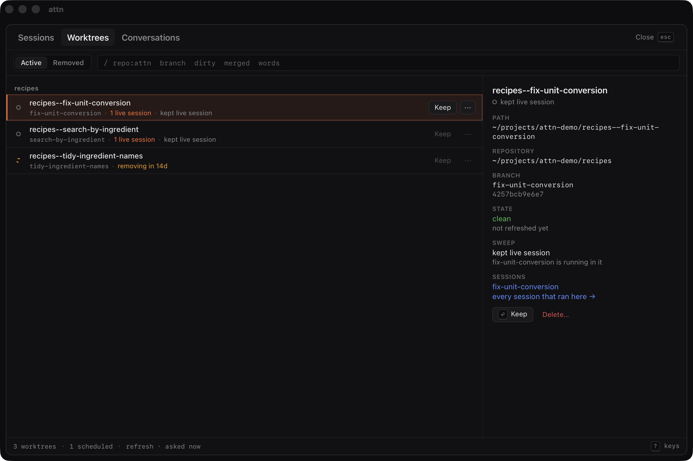
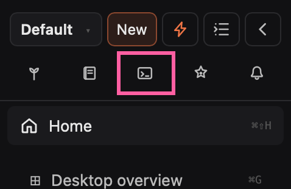

# Sessions

A session is Attn's record of one conversation with an agent. Attn keeps every
session, live and closed, so you can always find an agent again and bring it
back.

## Opening an agent

Cmd+N (Ctrl+Shift+N on Linux), or New at the top of the sidebar, opens the
picker. Pick a harness or a plain shell, then a directory. In a git repository,
Tab moves on to where the agent works: a new worktree (type to name its
branch), the main checkout, or a worktree that already exists. Enter starts it.

Attn runs Claude Code and Codex, and Pi through its plugin. You get each harness
as its makers built it, and you can still use its bare CLI whenever you want.
Nisse is experimental and off by default; [Using Nisse](using-nisse.md) covers
it.

## Worktrees

Worktrees let many agents work on the same codebase in parallel without
stepping on each other: each agent gets its own isolated checkout.

Attn creates worktrees for your agents and removes them automatically once
nothing would be lost: no agent running in it, no open seed pointing at it, no
uncommitted, unmerged or unpushed work, and two weeks without activity.

You can see and manage your worktrees in the ledger's Worktrees tab, and keep
one forever from there.

## The terminal

- Cmd+F (Ctrl+Shift+F on Linux) searches the whole scrollback.
- Cmd-click (Ctrl-click on Linux) a path or URL to open it. A `.md` file opens
  in a markdown tile next to the agent.
- If your shell marks commands (fish does by default), click a command's output
  to select the whole block. Cmd+C (Ctrl+Shift+C on Linux) copies the command
  and its output, Cmd+Shift+C (Ctrl+Alt+C on Linux) only the command.
  Right-click a block for Copy output, Filter block output, and scrolling to
  its top or bottom.

## Durability

Restarting the app or the daemon doesn't interrupt your agents. After your
machine reboots, your sessions come back, and each one restarts when you open
it.

## The ledger

Cmd+Shift+L (Ctrl+Alt+L on Linux), or the Ledger icon at the top of the
sidebar, opens the ledger: every session, live and closed, plus the worktrees
and conversations they used, in the Sessions, Worktrees and Conversations tabs.
When you close an agent, it waits here.

## Resume

Resume brings a closed session back as itself, in a tile, with its
conversation. The ledger labels this action **Reopen**. It lands on the
session's last desktop, or on the current one.

Attn keeps its own copy of conversations a harness would delete. Keep one
forever with Keep conversation on its session in the ledger, and forget it from
the Conversations tab.

## Reload

"Reload this agent" in the command palette (Cmd+Shift+K, or Ctrl+Alt+K on
Linux), or Reload session in the ••• menu on its sidebar row, restarts an agent
in place with its saved conversation. Running work is interrupted and
non-persistent state may be lost.

Agents can do the same with `attn agent reload <session-or-member>...`. A
session may reload itself and the agents it delegated to, including delegates
of delegates, and the Chief may reload any agent in its profile, or
every agent there with `--all`. A crew member's name reaches their current
session; a sleeping member stays asleep. Shells are never reloaded. Run
`attn agent reload --help` for the details.

## Details

Why did my worktree disappear?

The sweep removed it once it had gone 14 days without activity with nothing left to lose. The sweep runs every hour and covers every worktree of a repository where Attn has made one, including worktrees you added with git yourself. Removing a worktree also deletes its local branch, unless an open seed can still continue from it, and leaves a note on the seeds that worked there. The Worktrees tab's Removed list shows when it went and why, and resuming a session that ran there offers "Recreate the worktree" while the branch is still local, or "Fetch, recreate, reopen" when only a remote has it.

Does closing an agent's tile stop the agent?

Yes, when it is the agent's only tile. Cmd+W (Ctrl+Shift+W on Linux) on it, or Close session in the ••• menu on its sidebar row, stops the agent and puts its session in the ledger as closed by you, ready to resume. When another tile still shows the same agent, Cmd+W closes only the tile you're in. On a tile that isn't a terminal, such as markdown or a browser, Cmd+W closes only that tile. The Chief's session refuses to close until you remove its chief role (Remove chief role in its ••• menu), and a crew member's session refuses until you put the member to sleep. An agent that exits cleanly closes its session the same way. When it crashes or something kills it, its tile stays and says "Agent stopped", with Resume to continue the conversation and Close to close the session.

Why can't I resume a closed session?

Resume starts the session's own harness with the model and effort it launched with, in its saved directory, and warns you when that directory is on a different branch now. The ledger refuses and says why when the harness isn't installed or can't resume, when Attn saved no launch settings or conversation id for the session, when the harness no longer has the conversation and Attn has no copy (the reason says when a copy was deleted), or when the session's profile was deleted. When the directory is gone, it offers "Recreate the worktree" while the branch is still local, or "Fetch, recreate, reopen" when only a remote has it, and nothing when it wasn't a worktree or the branch is gone or checked out somewhere else. `attn session show <id>` prints the same verdict, and `attn session reopen <id> --action recreate_worktree_and_reopen` (or `fetch_recreate_and_reopen`) runs those actions from the terminal.

Why is Attn keeping my worktree?

Its row in the Worktrees tab, and `attn worktree list`, names the first thing keeping it, and selecting the row shows the full reason. In order, Attn checks whether you kept it forever, an agent is running in it, an open seed points at it, it has uncommitted, untracked or stashed changes, a detached HEAD holds commits that are on no branch, its branch hasn't merged, or it has commits the merge doesn't account for. A branch counts as merged when GitHub shows its pull request merged, or when its work is already in the branch the repository merges into (named next to the repository), squash merges included. Idle time starts at the newest file change, commit or creation, and a younger worktree shows a "removing in" countdown that only means Attn looks closer when it ends, so anything above can still keep it.

What happens to my agents when the daemon restarts or my machine reboots?

Your agents run outside the daemon, so a daemon restart leaves them running. If the daemon can't start its terminal workers, it falls back to running terminals inside itself and the app shows a warning that says "Falling back to embedded". In that mode a daemon restart stops every agent. After a reboot, or after an embedded daemon restarts, each session stays on its desktop marked recoverable, and opening it starts its harness again with the conversation resumed.

Which conversations does Attn keep a copy of?

Only Claude Code's, since Claude Code prunes its conversations after 30 days and the other harnesses keep their own. Attn copies a conversation while it belongs to the latest delegation of an open seed, while a crew member's letter points at its session (only letters filed with Crew v2 on record their session), or once you keep it with Keep conversation on its row in the Sessions tab, Keep forever in the Conversations tab, or `attn conversation keep <session-id>`. It waits until a live conversation has been quiet for a day. The copies live compressed in `~/.attn/conversations/`, and when you resume a conversation Claude Code no longer has, Attn puts its copy back first. Once nothing holds a copy, Attn deletes it 14 days later (the Conversations tab shows the date). Forget deletes it right away without touching Claude Code's files. It refuses while an open seed still needs the copy, and when crew letters hold it, it names them; `attn conversation forget <id> --unlink-crew-letters` forgets it anyway and leaves the letters in place.

How do I keep a worktree forever, or let it go again?

Keep on its row in the Worktrees tab, or `attn worktree keep <path>`, pins it so the sweep never removes it, and Unpin (`attn worktree unkeep <path>`) lets the next pass decide again. Turning off Worktree sweep in Settings > Files and locations stops automatic removals everywhere and keeps your pins. Worktrees it would remove then say "eligible now; the sweep is off". The refresh link at the bottom of the Worktrees tab, or `attn worktree refresh`, runs a pass now instead of waiting for the hourly one.

How do I find an old session in the ledger?

The Sessions tab shows Live, Closed or All, and the filter narrows it with `repo:name`, `profile:name`, `today`, `yesterday`, `7d`, `30d`, `from:2026-09-01 to:2026-09-05`, `dir:path` or plain words. Words and `dir:` search only the rows already loaded, so pull in older ones from the "older" link in the status bar first. Your Live, Closed or All choice, repository, profile and dates stay set the next time you open the ledger, and `attn session list --closed --last 7d` reads the same ledger from the terminal. Inside the ledger, / jumps to the filter, [ and ] switch tabs, Enter runs a row's main action, . shows its other actions, 1 to 9 run the nth one, y copies the row's path, and ? lists every key.

What happens when I delete a worktree myself?

Delete… on its row in the Worktrees tab, Cmd+Backspace (Ctrl+Backspace on Linux) on it in the picker, or `attn worktree delete <path>`, removes the checkout and closes every session still running in it. It also deletes the worktree's local branch, even when the branch isn't merged, unless an open seed can still continue from it. A worktree with uncommitted changes asks you to confirm "Delete, losing changes" (`--force` on the CLI), and the Removed list records it as deleted at your request.

