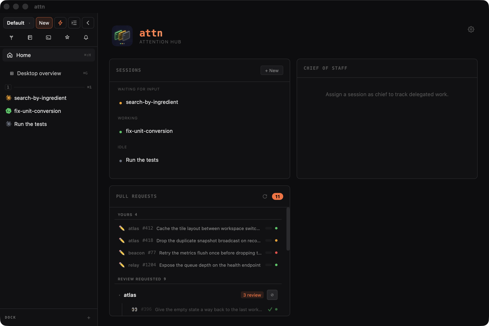

# Getting started

From a fresh install to your first agent, with the Chief at your side.

## Before you install

You need:

- At least one agent CLI installed: Claude Code, Codex or Pi. Attn
  runs them as they are, so install and log into the one you use.
- The [GitHub CLI](https://cli.github.com/) (`gh`) 2.81 or newer, if you want
  the PR features.

## Install

### Mac (Apple Silicon)

Use Homebrew or the direct installer. We recommend Homebrew.

```bash
brew tap victorarias/attn https://github.com/victorarias/attn
brew install --cask victorarias/attn/attn
```

Or grab the DMG from the
[latest release](https://github.com/victorarias/attn/releases/latest), open it
and drag Attn to Applications.

To update:

```bash
brew update && brew upgrade --cask victorarias/attn/attn
```

The app tells you when a new release is out. On its first start after an update,
Attn snapshots its database into `~/.attn/backups/` before upgrading it. Attn is
also designed to restart without interrupting the user or its agents, so you can
always update without worry.

### Linux

Releases don't package the Linux app yet, so build it from source. We test on
Ubuntu 24.04.

You need Go 1.27+, Rust (stable), Node.js 26+, pnpm, bun, and these packages:

```bash
sudo apt install build-essential pkg-config libwebkit2gtk-4.1-dev \
  libayatana-appindicator3-dev librsvg2-dev libssl-dev libxdo-dev \
  desktop-file-utils
```

Then:

```bash
git clone https://github.com/victorarias/attn.git && cd attn
make
```

`make` builds the app and the daemon, installs them under
`~/.local/share/attn`, and launches the app. `make install` skips the launch.
To update, pull and run `make` again; source builds don't check for releases.

## The home screen

Welcome to Attn! The first thing you see is your home screen.



This is where you keep an eye on all your agents and your open PRs. From here
you can set up your Chief, or go straight to starting agents and getting things
done.

The sidebar on the left lists your desktops and agents. Cmd+B (Ctrl+Alt+B on
Linux) shows and hides it.

## Set up the Chief

The Chief is a permanent agent that helps you manage your agents and your
efforts. The Chief can:

- Create and manage any agent running in Attn.
- Change your Attn settings.
- Guide you in how to use Attn.

Check your sidebar to pick your initial Chief setup and wake it. In its first
session, the Chief guides you through Attn and sets things up with you: which
roles your delegated agents use and how your Notebook is laid out. It can also
give you a tour of the app and build something small with you. To go through
onboarding again later, ask the Chief or run `attn onboarding again`.

After that, the Chief is your agent, and you can use it however you like. Its
official purpose is to help you manage Attn and your own efforts, but you can do
whatever you want with it.

One common way to use it: plan your day with it, and ask it to delegate agents
to work on things. The Chief keeps track of their work in the garden and
journals the day in the Notebook, so you can check back later on what you did.

## Start an agent

You don't have to use the Chief to create agents. Cmd+N (Ctrl+Shift+N on Linux)
starts one yourself: pick a harness or a plain shell, pick a directory, go. It
opens on the desktop you're on, beside the agent you're looking at. Cmd+Shift+N
(Ctrl+Alt+N on Linux) opens it below instead.

## Know who needs you

Attn was built to help you run many agents in parallel while keeping the mental
cost low. It does that by removing every bit of friction it can, so you spend
your energy on the decisions that matter.

The most basic way it helps is using colors to signal state. Instead of jumping
between agents to find out whether they need you, Attn tracks each agent's state
and shows it as a color, so you scan for colors instead of reading terminals:

| Color               | What it means                                                           |
| ------------------- | ----------------------------------------------------------------------- |
| 🟢 Green            | Working. Leave it alone.                                                |
| 🟡 Amber            | Waiting for you: it asked a question, or finished and wants your input. |
| 🟡 Flashing         | Needs approval for a tool call. Go approve.                             |
| 🔵 Blue, slow pulse | Agent is idle with scheduled work. It will continue by itself.          |
| ⚪ Gray             | Idle, finished with nothing running, or stopped and recoverable.        |
| 🟣 Purple           | Attn can't tell what it's doing. Worth a glance.                        |

The colors work the same regardless if you're using the desktop flow or queue
flow. The queue goes one step further: it takes "which agent do I go to next?"
off your plate by bringing you the next one that needs you. Less deciding, more
throughput. See [queue](../reference/queue.md).

## Where next

You can now use Attn as a basic orchestrator, congrats!!! Now comes the fun
part: getting a lot more done by orchestrating dozens of agents at the same
time.

- Hand work off to other agents with [delegation](../reference/delegation.md),
  and keep track of it in the [garden](../reference/delegation.md#the-garden).
- Get a shitload of work done with delegation roles:
  [building-with-roles](building-with-roles.md). Your
  [delegation roles](../reference/delegation.md#roles) decide which harness and
  model each kind of task gets.
- Go hardcore with the agent [queue](../reference/queue.md).
