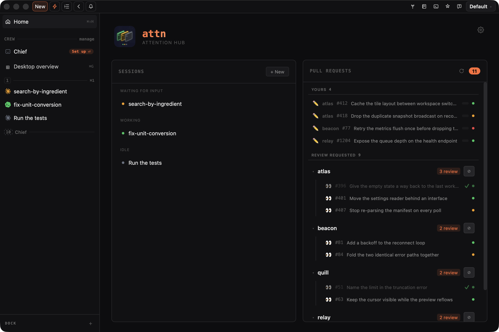

# Getting started

From a fresh install to your first agent.

## Before you install

You need:

- At least one agent CLI installed: Claude Code or Codex. Attn runs them as
  they are, so install and log into the one you use.
- The [GitHub CLI](https://cli.github.com/) (`gh`) 2.81 or newer, if you want
  the PR features.

## Install

### Mac (Apple Silicon)

Use Homebrew or the DMG. We recommend Homebrew.

```bash
brew tap victorarias/attn https://github.com/victorarias/attn
brew install --cask victorarias/attn/attn
```

Or download the DMG from the
[latest release](https://github.com/victorarias/attn/releases/latest), open it
and drag Attn to Applications.

To update:

```bash
brew update && brew upgrade --cask victorarias/attn/attn
```

The app tells you when a new release is out. When a new version needs to
upgrade the database, Attn first saves a snapshot in `~/.attn/backups/`. Attn
is designed to restart without interrupting you or your agents, so you can
update at any time.

### Linux

The Linux app is still in progress, and releases don't package it yet, so build
it from source. We test on Ubuntu 24.04.

You need Go 1.27.1 or newer, Rust through rustup (the repository pins the Rust
version to use), Node.js 26 or newer, pnpm 9 or newer, and these packages:

```bash
sudo apt install build-essential pkg-config libwebkit2gtk-4.1-dev \
  libayatana-appindicator3-dev librsvg2-dev libssl-dev libxdo-dev \
  desktop-file-utils xdg-utils
```

Then clone the repository and build:

```bash
git clone https://github.com/victorarias/attn.git && cd attn
make
```

`make` builds the app and the daemon, installs them in `~/.local/share/attn`
(`$XDG_DATA_HOME/attn` if you set it), and launches the app. `make install`
skips the launch. Start the app later with `~/.local/share/attn/bin/attn-app`.
To update, pull and run `make` again. Source builds don't check for releases.

## The home screen

Welcome to Attn! On first start, Attn opens a short intro to profiles,
desktops, the queue and the palettes. You can replay it from the banner on the
home screen, or with **What's new** in the command palette (Cmd+Shift+K,
Ctrl+Alt+K on Linux).

Then you see your home screen. Cmd+Shift+H (Ctrl+Alt+H on Linux) brings you
back to it at any time.



This is where you watch all your agents and your open PRs:

- **Sessions** lists every agent, grouped by state. Click one to go to it, or
  click **+ New** to start one.
- **Pull Requests** lists your PRs and the ones waiting for your review, with
  their CI status. This list needs `gh`.

Every profile also has a Chief, a crew member that keeps track of your other
agents, delegates work for you and journals your day in the Notebook. Read
[The Chief](../reference/chief.md) to set it up and see how it onboards you on
its first day.

The gear at the top right opens Settings (Cmd+, or Ctrl+Shift+, on Linux).

The sidebar on the left lists your desktops and the tiles on them. Cmd+B
(Ctrl+Alt+B on Linux) collapses and expands it.

## Start an agent

Cmd+N (Ctrl+Shift+N on Linux) starts an agent: pick a harness or a plain shell,
pick a directory, and start. The agent opens on the desktop you're on, beside
the tile you're looking at. Cmd+Shift+N (Ctrl+Alt+N on Linux) opens the agent
below that tile instead. Cmd+T (Ctrl+Shift+T on Linux) opens the same picker
with a plain shell chosen.

## Know who needs you

Attn helps you run many agents in parallel at a low mental cost. It removes
every bit of friction it can, so you spend your energy on the decisions that
matter.

The most basic help is color. You don't need to jump between
agents to find out whether they need you. Scan the colored dots instead of
reading terminals. Attn tracks each agent's state and shows the state as a dot:

| Dot                 | State          | What it means                                                       |
| ------------------- | -------------- | ------------------------------------------------------------------- |
| 🟢 Green            | Working        | Busy. Leave it alone.                                               |
| 🟡 Amber            | Waiting        | It ended its turn asking you something, or it stopped on an error.  |
| 🟡 Yellow, flashing | Needs approval | Blocked on a prompt you must answer, like a tool approval. Go answer it. |
| 🔵 Blue, slow pulse | Scheduled      | Parked on a schedule it set. It will continue by itself.            |
| ⚪ Gray             | Idle           | Finished, with nothing to ask you.                                  |
| ⚪ Gray             | Recoverable    | Stopped, and Attn can bring it back.                                |
| 🟣 Purple           | Unknown        | Attn can't tell what the agent is doing, and the state may be an error. Hover the dot to see why. |
| An emoji            | Launching      | Starting up.                                                        |

The home screen groups your agents by the same states.

The colors work the same in desktop flow, which is the default, and in queue
flow. Queue flow adds one thing. It brings you the next agent that needs you, so
you don't have to decide which agent to go to next. You decide less and get more
done. See [queue](../reference/queue.md).

## Where next

You can now use Attn as a basic orchestrator. The next step is to get a lot more
done by orchestrating dozens of agents at the same time.

- Arrange your work on [desktops](../reference/desktops.md), and find, resume
  and close agents with [sessions](../reference/sessions.md).
- Hand work off to other agents with [delegation](../reference/delegation.md).
- Take on larger work with delegation roles:
  [building with roles](building-with-roles.md).
- Go further with the agent [queue](../reference/queue.md).
