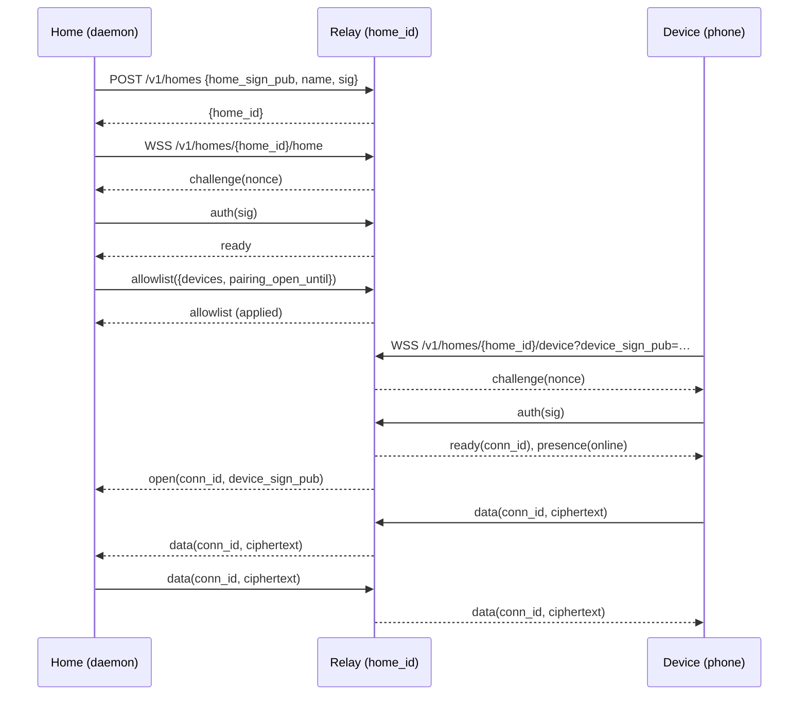

# Cloud Relay contract

Version 1. Attn Cloud serves it at `https://cloud.attn.codes`.

A Cloud Relay connects a phone to the attn daemon on a person's computer. The daemon (the **home**) dials out to the relay and phones (**devices**) dial in. The relay routes bytes between them without reading them: the home and each device run a Noise session end to end inside the frames described here, so the relay only sees connection ids and ciphertext.

Each home has one relay, named by its `home_id`. Every socket of that home, and of its devices, ends in that relay.

attn owns this contract, because attn's clients are what it binds: the daemon's cloud link (`internal/cloudlink`) and the phone app (`mobile/`). Any server that behaves as this document says is a Cloud Relay.

To check a relay, run the conformance suite against a fresh relay of your own, because each run uses up the day's new homes:

```sh
ATTN_RELAY_URL=http://127.0.0.1:<port> go test -count=1 ./internal/cloudlink/relaytest
```

attn runs the same suite against its own stand-in relay (`internal/testworld/cloud.go`), and `internal/cloudlink/testdata/relay_vectors.json` pins the bytes for both clients. A change to this document changes the suite in the same commit.



## Encodings

- Keys are Ed25519 public keys, 32 bytes. Signatures are Ed25519, 64 bytes.
- In JSON and URLs, keys and signatures are **base64url without padding** (RFC 4648 §5). A key is 43 characters.
- `home_id` is the first 16 bytes of `SHA-256(home_sign_pub)`, as lowercase base32 without padding (RFC 4648 alphabet `a-z2-7`): 26 characters. A client can compute it, but it uses the value the relay returns.
- Integers in frames are big-endian.

## HTTP errors

Every HTTP error has a JSON body:

```json
{
  "error": {
    "code": "unknown_home",
    "message": "home wzq3e4zlgbyopf77p4g6axtbwq is not registered"
  }
}
```

Clients branch on `code`. `message` is for people and may change.

| Status | `code`                 | When                                                                             |
| ------ | ---------------------- | -------------------------------------------------------------------------------- |
| 400    | `bad_request`          | a malformed body, key, signature or name; the message names the field            |
| 401    | `bad_signature`        | a registration or push token signature does not verify                           |
| 403    | `device_not_allowed`   | a push token's device is not on the home's allowlist                             |
| 404    | `unknown_home`         | no home is registered under that `home_id`                                       |
| 404    | `not_found`            | no such route                                                                    |
| 405    | `method_not_allowed`   | wrong method on a known route                                                    |
| 426    | `upgrade_required`     | a WebSocket route was called without `Upgrade: websocket`                        |
| 429    | `registration_limited` | the day's new relays are used up; the message names the limit and when it resets |

## Version

```
GET /v1/version
```

Response `200`:

```json
{ "commit": "28fd33201b5f4c7e8a9d0c1b2a3f4e5d6c7b8a90", "envelope_version": 1 }
```

`commit` is the Git commit of the running relay. `envelope_version` is the envelope version the relay speaks. No authentication.

## Registration

```
POST /v1/homes
content-type: application/json

{ "home_sign_pub": "<key>", "name": "Victor's Mac", "sig": "<signature>" }
```

`sig` signs the UTF-8 bytes of:

```
attn-cloud/v1 register\n<home_sign_pub>\n<name>
```

where `<home_sign_pub>` is the same base64url string as in the body. `name` is 1 to 100 characters.

Response `200`:

```json
{ "home_id": "wzq3e4zlgbyopf77p4g6axtbwq" }
```

Registration is idempotent by key: the same `home_sign_pub` always gets the same `home_id`, so a home retries freely. A later registration with the same key replaces the stored `name`.

At most 100 new relays are created per UTC day, across Attn Cloud. Past that, a key with no relay gets `429`:

```json
{
  "error": {
    "code": "registration_limited",
    "message": "100 new relays today, the limit is 100; try after 00:00 UTC"
  }
}
```

A key that already has a relay never counts and is never refused. A home that gets `429` keeps retrying, and it can register after 00:00 UTC.

### Deletion

A relay deletes itself 180 days after its home last registered or authenticated, unless a home is live at that moment, in which case the 180 days start again. Deletion closes every socket with `4410` and removes everything the relay stored: the home's key and name, the allowlist and the push tokens.

A deleted relay answers `404 unknown_home`. A home that gets this registers again and receives the same `home_id`, because the id comes from its key. This counts as a new relay. The home then sends its allowlist, as on every connect, so its phones are admitted again. Each phone must register its push token again, and until it does, a `push` frame for it gets `push_no_token`. The phone registers each time it connects to its home.

## Sockets

Both sockets are WebSockets that carry binary frames. The only text frame is the heartbeat (see [Heartbeats and presence](#heartbeats-and-presence)).

### Home socket

```
GET /v1/homes/{home_id}/home      (WebSocket upgrade)
```

Refused with `404 unknown_home` before registration.

### Device socket

```
GET /v1/homes/{home_id}/device?device_sign_pub=<key>      (WebSocket upgrade)
```

Admitted when `device_sign_pub` is on the home's allowlist, or when a pairing window is open (`now < pairing_open_until`). Otherwise the relay accepts the upgrade and closes the socket at once with `4403` and the reason `device is not on the home's allowlist and no pairing window is open`, before any frame. It does not answer HTTP 403, because a WebView's WebSocket reports a refused upgrade only as `1006`, the same as a network failure, and a phone revoked while it was offline must be able to tell that it was revoked. One device may hold several sockets to one relay, one per pairing (one per home profile).

### Authentication

On both sockets the relay sends `challenge` first. The client answers with one `auth` frame and waits for `ready` before sending anything else.

The `auth` payload is the client's signature over:

```
"attn-cloud/v1 auth home\n<home_id>\n" || nonce        (home socket, signed with the home key)
"attn-cloud/v1 auth device\n<home_id>\n" || nonce      (device socket, signed with device_sign_pub's key)
```

where the prefix is UTF-8 and `nonce` is the 32 raw bytes of the challenge payload.

A bad signature, or any frame other than `auth` before `ready`, closes the socket with `4401`.

When a home authenticates, the relay closes any older authenticated home socket with `4409`, sends `ready`, sends `open` for every device already connected, and sends `presence` online to every device.

When a device authenticates, the relay sends it `ready` carrying its `conn_id`, then `presence`, and sends the home `open`.

## Frames

Every binary frame is an envelope:

```
 0        1        2                          6
+--------+--------+--------+--------+--------+--------+-----------
| version| type   |        conn_id (u32 BE)           | payload …
+--------+--------+--------+--------+--------+--------+-----------
```

`version` is `1`. The relay closes a socket that sends any other version with `4400` and the reason `envelope version N unsupported; relay speaks 1`. While a relay updates, old and new code can run side by side for about five minutes, so a client that receives that close reconnects instead of failing.

`conn_id` names one device socket. The relay assigns it, it is never `0`, and it is unique among the relay's open sockets. Frames that are not about one device carry `0`.

| type | name        | direction                  | conn_id                        | payload                                              |
| ---- | ----------- | -------------------------- | ------------------------------ | ---------------------------------------------------- |
| 1    | `challenge` | relay → home, device       | 0                              | 32-byte nonce                                        |
| 2    | `auth`      | home, device → relay       | 0                              | 64-byte signature                                    |
| 3    | `ready`     | relay → home, device       | home: 0; device: its `conn_id` | empty                                                |
| 4    | `open`      | relay → home               | the device                     | its 32-byte `device_sign_pub`                        |
| 5    | `data`      | home ↔ relay ↔ device      | the device                     | opaque bytes                                         |
| 6    | `close`     | home → relay, relay → home | the device                     | empty                                                |
| 7    | `allowlist` | home → relay; relay → home | 0                              | JSON (home → relay); empty (relay → home)            |
| 8    | `presence`  | relay → device             | the device                     | 1 byte: `1` home online, `0` home offline            |
| 9    | `error`     | relay → home, device       | 0                              | JSON `{"code", "message"}`                           |
| 10   | `push`      | home → relay               | 0                              | JSON (see [Push notifications](#push-notifications)) |

### `data`

A device sends `data` with its own `conn_id` (from `ready`). Any other `conn_id` closes it with `4400`. The relay forwards the frame unchanged to the home, so the home reads the sender from `conn_id`.

The home sends `data` with the target device's `conn_id`. The relay forwards it unchanged to that device. If no such device is connected, the relay answers the home with `close` for that `conn_id`.

A device that sends `data` while its home is offline gets `presence` `0` back, and the frame is dropped.

The relay never reads, buffers or retries the payload. Each side caps its own frames; the home caps a frame at 64 KiB.

### `close`

Home → relay: close that device's socket, with `4000`. Relay → home: that device's socket is gone, or a `data` frame named a device that is not connected.

### `allowlist`

The home sends the full list of devices allowed to connect, replacing the previous one:

```json
{ "devices": ["<device_sign_pub>", "…"], "pairing_open_until": 1793600000000 }
```

`pairing_open_until` is Unix time in milliseconds. While `now < pairing_open_until`, devices not on the list are admitted too, so a new phone can reach the home to pair. `0` means no window is open. The home sends the list again on every connect and after every pairing or revoke, and closes the window as soon as the pairing completes.

The relay stores the list, closes every device socket that the new list no longer admits with `4403` (sending the home `close` for each), deletes the push tokens of devices no longer on the list, and answers with an empty `allowlist` frame once the list is in effect.

The allowlist holds at most 1000 devices. A list that is malformed or too long is not applied; the relay answers with `error` `bad_allowlist`, and the message names the problem (for example `allowlist has 1200 devices; the limit is 1000`).

The allowlist turns away unknown devices early. It is not the trust boundary: the home still authenticates every device in the Noise handshake.

### `error`

Non-fatal. The socket stays open. `code` values:

| `code`              | Meaning                                                                                                       |
| ------------------- | ------------------------------------------------------------------------------------------------------------- |
| `bad_allowlist`     | the allowlist was not applied; see the message                                                                |
| `bad_push`          | a malformed `push` frame; the message names the field                                                         |
| `push_refused`      | the `push` frame's device is not on the allowlist                                                             |
| `push_no_token`     | the device has no push token registered                                                                       |
| `push_unconfigured` | this relay has no APNs credentials                                                                            |
| `push_too_large`    | the APNs payload would be over APNs's 4096-byte limit; nothing was sent                                       |
| `push_failed`       | APNs refused the notification or could not be reached; the message carries APNs's status and reason           |
| `unsupported_type`  | the relay does not accept this frame type from this side; a newer client talking to an older relay may see it |
| `text_frame`        | a text frame other than `ping`                                                                                |

## Push notifications

The home sends a paired phone a notification while the app is closed, such as "an agent is waiting". The home encrypts the content to the device's key; the relay forwards the ciphertext to the Apple Push Notification service (APNs), and the phone's notification service extension decrypts it. The relay never sees the content.

### Registering a push token

A device on the home's allowlist registers its APNs device token:

```
POST /v1/homes/{home_id}/push-token
content-type: application/json

{
  "device_sign_pub": "<key>",
  "platform": "apns",
  "environment": "sandbox",
  "token": "<lowercase hex APNs device token>",
  "sig": "<signature>"
}
```

`platform` is `apns`. `environment` is `sandbox` or `production`, the APNs environment the app was built for. `token` is lowercase hex of 16 to 200 bytes; APNs tokens are 32 bytes today. `sig` is the device's signature, with `device_sign_pub`'s key, over the UTF-8 bytes of:

```
attn-cloud/v1 push-token\n<home_id>\n<device_sign_pub>\n<environment>\n<token>
```

where `<device_sign_pub>` is the same base64url string as in the body.

Response `200`: `{}`. A device with no allowlist entry gets `403 device_not_allowed`, even inside a pairing window, so a phone registers after its pairing completes and the home has sent the allowlist that includes it.

The relay keeps one token per device and replaces it on every registration, so a device registers again whenever iOS hands it a new token, and retries freely. A token is deleted when the allowlist drops its device, and when APNs reports it dead (below).

### `push`

The home sends a `push` frame with `conn_id` `0`:

```json
{ "device": "<device_sign_pub>", "ciphertext": "<base64url>", "collapse_id": "session-1" }
```

`ciphertext` is opaque, non-empty base64url without padding. `collapse_id` is 1 to 64 bytes; APNs shows only the newest notification with a given id. The device does not need to be connected.

The relay sends APNs, in the environment the device registered, a notification with topic `codes.attn.mobile`, the `collapse_id` as its collapse id, and this payload:

```json
{"aps":{"alert":{"title":"attn","body":"An agent is waiting"},"mutable-content":1,"sound":"default"},"attn":"<ciphertext>"}
```

The phone's extension replaces the alert with the decrypted content; the alert in the payload is what the phone shows when it cannot decrypt. The payload with the ciphertext must fit in APNs's 4096 bytes, which leaves 3985 characters of base64url: 2988 bytes of ciphertext.

A delivered `push` gets no answer. A refused one gets an `error` frame naming the device: `bad_push`, `push_refused`, `push_no_token`, `push_unconfigured`, `push_too_large` or `push_failed`. When APNs answers `410`, or `400` with the reason `BadDeviceToken` or `DeviceTokenNotForTopic`, the relay also deletes the device's token, and later pushes get `push_no_token` until the device registers again.

## Heartbeats and presence

Either side may send the text frame `ping`. The relay answers with the text frame `pong`.

The home must send `ping` at least every 20 seconds. The relay treats a home as offline when neither a `pong` nor its authentication happened in the last 60 seconds. The relay checks this whenever a device connects or sends `data`. A home found silent is closed with `4408`, and its devices get `presence` `0`. The relay does not check at any other time, so a device that sends nothing learns of a silent home from its own heartbeat to the home, not from the relay.

Devices learn presence:

- at connect, right after `ready`;
- `1` when a home authenticates;
- `0` when the home socket closes or is found silent;
- `0` in answer to `data` sent while the home is offline.

A relay update drops busy sockets without a close frame. Both sides treat EOF without a close code as a normal reason to reconnect.

## Close codes

| Code | Side   | Meaning                                                                                                   |
| ---- | ------ | --------------------------------------------------------------------------------------------------------- |
| 4000 | device | the home closed this connection (`close` frame)                                                           |
| 4400 | either | malformed frame: shorter than 6 bytes, unsupported version, or a device's wrong `conn_id`                 |
| 4401 | either | authentication failed, or a frame came before `ready`                                                     |
| 4403 | device | the device is not on the allowlist and no pairing window is open, at connect or after an allowlist change |
| 4408 | home   | no `ping` for 60 seconds                                                                                  |
| 4409 | home   | a newer home connection replaced this one                                                                 |
| 4410 | either | the relay deleted itself after 180 days with no home; a home registers again, and a device retries        |

## Changes

The contract changes by addition. A new frame type or field is added to this document with the version that introduced it; existing frames keep their meaning. A breaking change raises the envelope version, and the relay then serves both versions until no client speaks the old one.

Version 1 history, before the first deploy:

- A device that is not admitted gets its upgrade and then close `4403`, instead of HTTP `403 device_not_allowed`.

Additions to version 1:

- `GET /v1/version`.
- Push notifications: `POST /v1/homes/{home_id}/push-token`, the `push` frame (type 10), the `push_*` and `bad_push` error codes, and HTTP `403 device_not_allowed` for push token registration.
- HTTP `429 registration_limited` on `POST /v1/homes`.
- A relay deletes itself after 180 days with no home connection, closing its sockets with `4410`.
