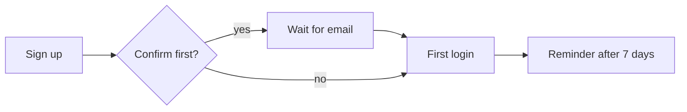

Signup can let people in before they confirm their email, or hold them until they do.

:::question
Should new accounts confirm their email before the first login?
Holding them cuts spam signups, but about one in five never finds the email.
- [ ] Confirm later — no lost signups, reminder after 7 days
- [ ] Confirm first — fewer spam accounts, some signups lost
Recommended: Confirm later
:::
