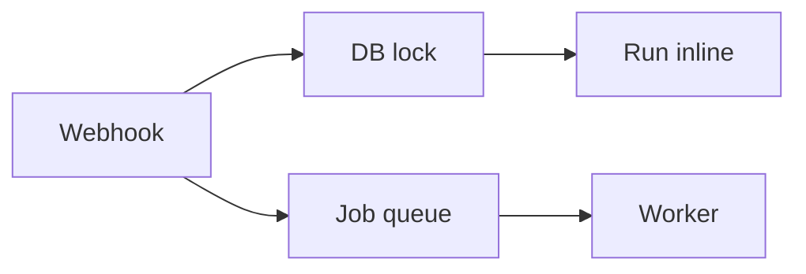

Retries can run inline under a DB lock or through the job queue.

:::question
Which retry path should we build?
Inline lock avoids a new service, but holds DB connections during webhook bursts.
- [ ] Job queue — absorbs bursts, adds one worker
- [ ] DB lock — simpler now, blocks under spikes
Recommended: Job queue
:::
