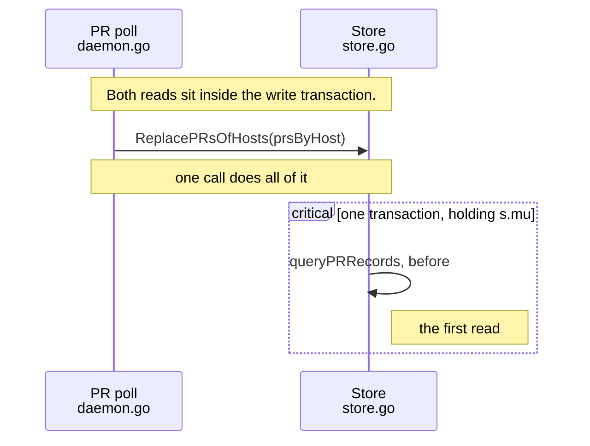

# Review

To present a change, write a review document and open it for the user. A review document is a markdown file that tells the story of the change and points at the code. The user reads it in a tile, writes notes and questions on lines, edits lines, and sends one review back with a verdict.

Present a change when the user asks you to present it, to review it, or to show what you did. Present it also when you finish a change and the user wants to review it before it goes further. A small change the user can judge from one sentence needs no review document.

## Present a change

1. Pick where the document lives: your seed's artifact folder when you tend a seed, else your scratch folder. Never put it in the repository's tracked tree.
2. Write the review, as the next sections describe. To pick a frame, put `frame:` in the document's frontmatter.
3. From the repository, start the review:

   ```sh
   attn review start <document> --base <commit>
   ```

   `attn review start` records the working tree as the review's head. It writes `attn`, `repository`, `base` and `head` into the document's frontmatter, and `frame` when the document picks none. It keeps the rest of the document. Pick the base for what you changed:

   | You changed | Base |
   |---|---|
   | commits on a branch, perhaps with uncommitted work on top | `--base "$(git merge-base HEAD origin/main)"` |
   | only uncommitted work | `--base HEAD` |
   | nothing: you are showing how existing code works | no `--base`, on a new document. The review is a tour |

4. Run `attn review check <document>`. Each problem names its line and the fix. Fix them all.
5. Run `attn open <document>`. It prints any problem left as a warning and opens the tile anyway.

Keep the frontmatter that `attn review start` wrote. If you write the whole file again, run `attn review start <document>` again to put it back.

To present the same document again after you change the code, revise the review, then run `attn review start <document>` with no `--base`, check it and open it. The base stays where it was, or moves to what the user last reviewed, so the user sees only what changed since their notes. An open tile reloads by itself.

## Write the review

Write for a reader who has not seen the conversation. Put in:

- A title, then what changed and why, in a few sentences.
- Where the user should look: the line where behavior changes, the decision they might disagree with, the case you are unsure about. Say it in a callout and mark that line with `!`.
- An example in plain terms: an input and what happens to it now, before and after.
- A sequence diagram when the change is a flow across components.
- Steps, each a `##` heading with a short paragraph, in the order that explains the change. That order is rarely file order. Lead with the line that matters, then what feeds it.
- Stops under the steps. A stop is a `### path:from-to` heading. It shows those lines of the file at head, with the change from base drawn in. Show the lines that carry the point, not whole files. Under a stop, a note `- L12: text` explains line 12, and `- L12!: text` marks the place to look.
- A `## Not shown` list with every changed file no stop shows, each with the reason: `- path: why`. A `dir/` entry covers the files under it.

```markdown
---
frame: walkthrough
---

# Decide pull request changes inside the poll's replace

A poll compared two reads of the pull request table, so a detail refresh
between them looked like a change from GitHub. The store now decides what
changed while it replaces the rows.

> [!IMPORTANT]
> One line changes behavior: `comparePRRecords` uses `reflect.DeepEqual`.

For example, a refresh that only fills in a pull request's title used to
publish a change. Now it publishes nothing.

## The poll asks the store what changed

### internal/daemon/daemon.go:3775-3787

- L3781: The two `ListPRs` reads around this call are gone.

## The store compares the records

### internal/store/store.go:1290-1312

- L1301!: This was `wireEqual`, which compared JSON.

## Not shown

- internal/store/github_hosts_migration_test.go: a call site that ignores the new return value.
```

Use the forms in `attn skill --reference showing` for the prose. Every changed file needs a stop or a Not shown entry, and `attn review check` lists the ones that have neither.

A stop on a markdown file renders as a document, block by block, with the changed words marked. Use it for a change to docs or prompts.

`attn review --help` has the full grammar.

## Pick the frame

`frame:` in the frontmatter picks how the review opens. The user can switch.

- `map` when the change is a flow across components. Write a mermaid `sequenceDiagram` and put `%% stop: path:from-to` on the line after each message that a stop shows. The Map steps through those messages and shows, beside the diagram, the `##` step that holds each message's stop: its heading, its prose and its stops. Write that prose so it explains the arrow. To show the flow before and after the change, open one fence with `` ```mermaid before `` and one with `` ```mermaid after ``.
- `walkthrough` when the change sits in one or two files. The user steps through the stops with your prose beside the file.
- `brief` otherwise. The user reads the document top to bottom. `attn review start` writes `brief` when the document picks no frame.

Tell the story in the map's diagram, in plain mermaid:

- Caption each arrow with a `Note` on the line after its message, or after its `%% stop:`. The caption shows under the arrow: say what the call does or why it matters, in a few words.
- A `Note` before the first message captions the whole diagram.
- Wrap a transaction, a loop or a branch in a block, and the Map draws a labelled box around the messages inside: `rect`, `opt`, `loop`, `alt` with `else`, `critical` with `option`, `par` with `and`, or `break`, each closed by `end`.
- Give a participant a second line, such as its file, with `<br/>` in its name.

````markdown

````

The Map draws participants, actors, messages, notes and these blocks. `attn review check` names any other line, such as `activate` or `autonumber`, and a diagram with one shows as a mermaid figure that the Map cannot walk.

## Answer a question

A question from the user arrives as their message, with the lines it is about and an `attn review answer` command. Answer with that command. The answer shows under the line in the user's review, so write it to stand there: a sentence or two that answers the question, with a file and line when that helps.

The user is still reading, so leave the files alone. When the question shows that something needs to change, say so in the answer and make the change after the user sends the review.

## Act on the verdict

The user sends the review as one message: their notes in reading order, then their edits, then a verdict. Their edits are already saved in the working tree. Build on them and do not undo them.

- Approve: address any notes, then carry on with the work, such as delivering it. Do not present the change again.
- Request changes: address each note. Then present the same document again: revise it for what changed, run `attn review start <document>`, check it and open it.
- Comment: reply to the notes in the conversation. Change code only where a note asks for it.

## Code navigation

In the review, the user can go from a name to its definition, its uses and its type. A language server on the machine that holds the files answers, and attn starts it when the review opens. A language with no working server still reads, and the tile's key line says `no server` for it. When the user presses `s` on that line, an agent sets up a server. `attn skill --reference code-navigation` is that agent's guide.
