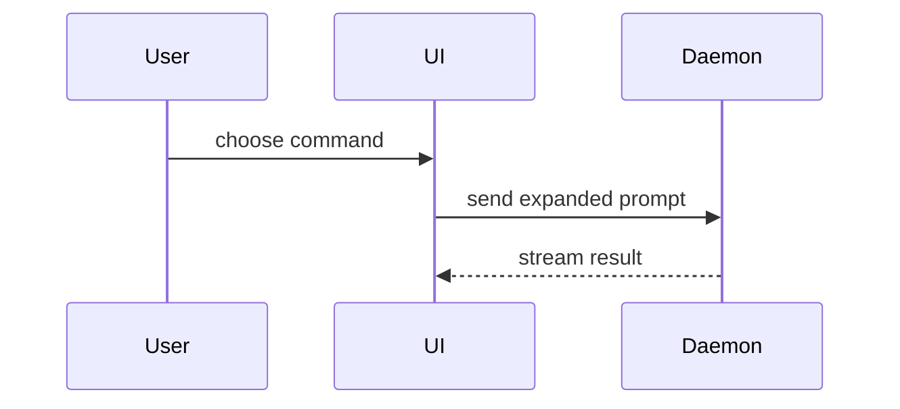

# Showing instead of narrating

Guidance for any text another reader must understand. Make it easy to
read without losing precision: plain words over jargon, short paragraphs
over long ones, and a sketch wherever it says more than the sentences it
replaces. Pick the smallest view that makes the key point clear, and
skip the preamble.

A seed and a markdown file render markdown and Mermaid. A reply in the terminal
conversation shows plain text, so draw pictures there as text and use Mermaid
only in a seed or a markdown file.

- Show logic or an algorithm as pseudocode:

```text
on(save)
  if content is unchanged
    return cached result
  write new content
  return fresh result
```

- Show runtime control flow as a call tree:

```text
submitForm
  createSession
    persistPrompt
    launchAgent
  navigateToSession
```

- Show UI structure as a component tree, including state and module
  boundaries that matter:

```tsx
<SessionPage> (apps/example/src/routes/session.tsx)
  useSessionEvents()
  <SessionToolbar>
    <RunSkillButton> (packages/ui)
```

- Show file responsibility or a broad refactor as a shallow file tree:

```text
src/
├── commands/       # parses user actions
├── sessions/       # owns session state
└── transport/      # sends API requests
```

- In a seed or a markdown file, show component interaction, control flow, or data flow with Mermaid. In a reply in the terminal, draw the same as labeled arrows or a text sequence:



- Use `diff` when the point is what changes and the surrounding shape
  already exists. Match the diff shape to the topic: a component
  change, a file-layout change, a call-tree change, or a state or
  control-flow change:

```diff
 on(save)
-  write content
+  if content is unchanged
+    return cached result
+  write new content
+  invalidate cache
```

- Show the whole block when most of it is new, when omitted context
  would hide ownership or order, or when the reader needs a copyable
  target shape.

- When the content is too dense for these forms, such as a layout or a
  visual comparison, write a markdown document instead of forcing it into
  a comment. See [markdown.md](markdown.md).

Place each visual next to the short text it supports. Keep only the
calls, files, states, and boundaries needed to answer the reader's
actual question. Use one of these forms or several. You are unlikely
to need all of them. Use your judgement and do not overwhelm the reader.
