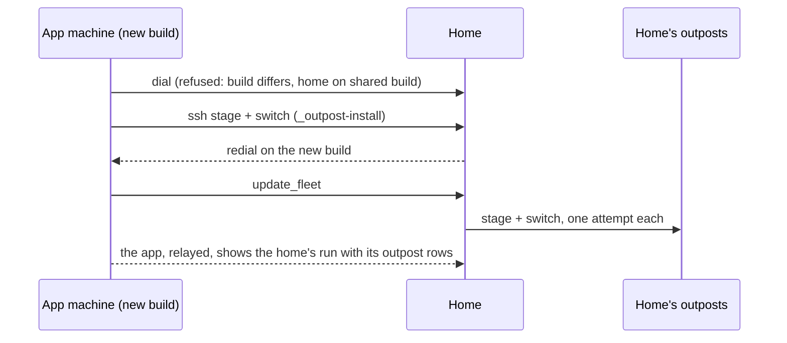

An app machine (one that dials its home) now updates its home to its own build by itself, once per build it installs, and the home then updates its outposts in the same run. Every failure shows on one list, with rows for the home and the app machine: one reason (no build, unreachable, refused, not back, behind), its cause and one action,: in `attn update status` on the app machine (also while the home is unreachable), and in the home's run (banner, Settings → Updates) once the home is back. The "Can't reach" screen's update line waits for s-kt444p's machine link. A failed update never starts again on a reconnect: the record of the shared build goes as the update starts.

