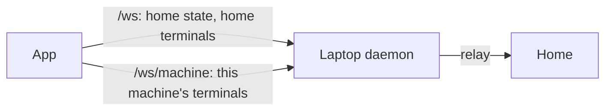

**The app machine's own terminals now run from its own daemon** (behind `remote_home_enabled`).

On a machine that dials its home, the app opens a second link, `/ws/machine`, to the daemon on its own port. Terminals that run on this machine attach, type and stream over that link. Home terminals, and the revive of a session, still go through the relay to the home. With 50 ms each way on the link, a keystroke echoes in 16 ms on the laptop's own terminal, against 102 ms for a home terminal and 203 ms for the laptop's terminal through the relay.

While the home is away, this machine's terminals keep working. A window that had the home's state keeps its desk under a **Lost** band, and the home's tiles keep their screen and refuse typing. A cold start shows this machine's terminals live in one row that is no desktop, and the home's desktops replace it when the home answers. The launcher, `terminal open --host`, `delegate --host` and an `attn://spawn` link opened on the machine now start there, instead of refusing.

